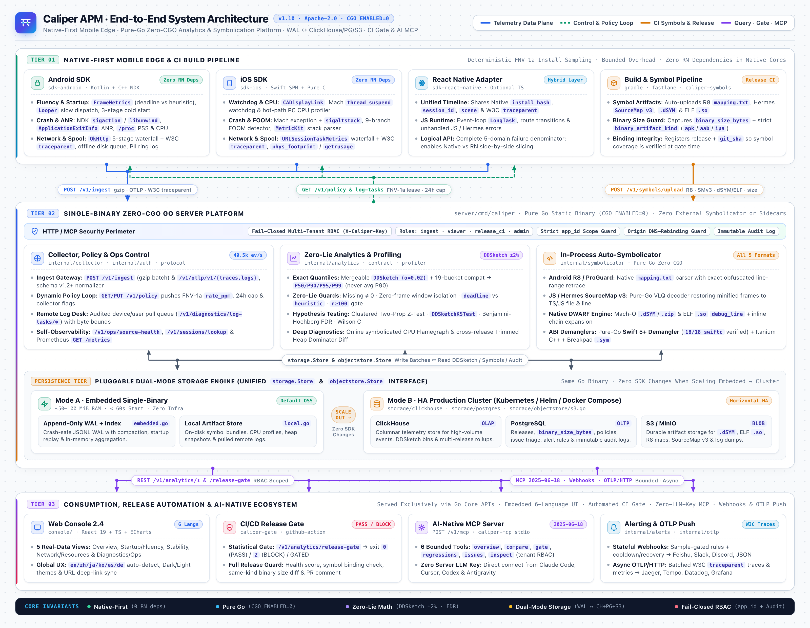

<div align="center">

# Caliper APM

**Native-First, React-Native-kompatibles, evidenzbasiertes (Zero-Lie) Open-Source Mobile APM**

[](https://caliper-apm.github.io/caliper/?lang=de&theme=dark)
[](LICENSE)
[](https://github.com/caliper-apm/caliper/releases)
[](https://github.com/caliper-apm/caliper/actions/workflows/ci.yml)
[](https://github.com/caliper-apm/caliper/actions/workflows/docker-e2e.yml)
[](server/go.mod)

[English](README.md) · [简体中文](README.zh-CN.md) · [日本語](README.ja.md) · [한국어](README.ko.md) · [Español](README.es.md) · **Deutsch**

**[🚀 Interaktive Live-Demo öffnen](https://caliper-apm.github.io/caliper/?lang=de&theme=dark)** · [Architektur](docs/architecture.md) · [Self-Hosting](docs/self-hosting.md) · [Android SDK](docs/sdk-android.md) · [iOS SDK](docs/sdk-ios.md) · [RN-Adapter](docs/sdk-react-native.md) · [Benchmarks](benchmarks/REPORT.md) · [Changelog](CHANGELOG.md)

<br />

<a href="https://caliper-apm.github.io/caliper/?lang=de&theme=dark"></a>

*Console 2.4 mit Echtdaten auf einer einzigen Zero-CGO-Go-Binary (~15 MiB im Leerlauf / ~69 MiB bei 30.000 Events): DDSketch (±2%) P50/P90/P95/P99-Trends, Release-Rollout-Marker, Native vs. React Native Vergleich, Dark/Light-Theme und 6-sprachige Oberfläche.*

</div>

---

## Console 2.4 Vorschau (100 % echte Telemetriedaten)

| **3-Phasen-Kaltstart & 19-Bucket-Latenzverteilung** | **Netzwerk & Ressourcen (5 Fehlerdomänen + Latenz)** |
| :---: | :---: |
|  |  |
| **Tiefendiagnose (CPU-Flamegraph & Heap-Leckvergleich)** | **Abstürze, ANR & Auto-Symbolisierung (Light Mode)** |
|  |  |

---

## Warum Caliper APM?

Viele mittlere und große mobile Apps setzen **nativen Code für leistungskritische Kernpfade (Feeds, Startzeit, Netzwerk, Medien)** und **React Native für schnell iterierende Produkt-Screens** ein. Caliper APM schließt diese Lücke mit fünf Kernprinzipien:

1. **Native-First-Kern + Erstklassiger RN-Adapter**: `sdk-android` (Kotlin + NDK) und `sdk-ios` (Swift SPM + C/Mach) haben **null React-Native-Abhängigkeiten**. Hybride Apps binden `sdk-react-native` nahtlos in denselben nativen Lebenszyklus, W3C-`traceparent` und dieselbe Symbolisierung ein.
2. **Zero-Lie-Statistik-Engine**: Abhängigkeitsfreies Pure-Go **DDSketch ($\alpha = 2\%$)** für zusammenführbare `P50 / P90 / P95 / P99`-Quantile, **`DDSketchKSTest`**, fenstergeclusterte Z-Tests für Fluency sowie **Benjamini-Hochberg-FDR**-Korrektur. Keine Null-Auffüllung fehlender Tage, strikte Zero-Frame-Isolation und explizite Stichprobengrenzen (`n >= 100`).
3. **Integrierte Zero-CGO-Auto-Symbolisierung**: Löst **R8/ProGuard**, **Source Map v3 (JS/Hermes)**, **Mach-O `.dSYM` / ELF `.so` DWARF (inkl. Inline-Expansion, Swift 5+ & Itanium-C++-Demangler)** und **Breakpad `.sym`** direkt im Go-Prozess auf — ohne externe Symbolicator-Dienste.
4. **CI/CD-Release-Gate & AI-Nativer MCP-Server**: `caliper-gate` CLI / GitHub Action blockiert statistisch signifikante Regressionen automatisch (`PASS` / `BLOCK` / `GATED` + artefaktreiner Binary-Size-Vergleich), und der Pure-Go-MCP-Server (`POST /v1/mcp` + `caliper-mcp`) verbindet Cursor, Claude Code, Codex und Antigravity mit RBAC-Mandantentrennung und **ohne serverseitige LLM-Keys**.
5. **Single-Binary in 60s → Horizontaler Cluster**: Lokal in Sekunden mit einer Go-Binary (Embedded WAL mit automatischer Kompaktierung) starten und in Produktion ohne SDK-Änderung auf **ClickHouse + PostgreSQL HA + S3/MinIO + Kubernetes Helm** skalieren.

---

## Mobile-SDK-Funktionsmatrix (Android · iOS · React Native)

| Bereich | Android SDK (Kotlin + C++ NDK · **0 RN-Deps**) | iOS SDK (Swift SPM + `8.4 KiB` C/Mach · **0 RN-Deps**) | React Native Adapter (Optional TS) |
|---|---|---|---|
| **Kaltstart & Fluency** | 3-Phasen-Kaltstart, `FrameMetrics` (`DEADLINE` vs. `heuristic`), `Looper`-Verlauf, `CaliperWatchdog` | 3-Phasen-Kaltstart, `CADisplayLink` (120Hz ProMotion), Mach-`thread_suspend`-Watchdog ohne Deadlock | JS-Event-Loop-`LongTask`, Routing & Native-vs-RN-Slicing |
| **Crash · ANR · FOOM** | NDK `libcaliper_native.so` (ohne `libc++_shared.so`, `SIGQUIT`-ANR-Forwarding) + `ApplicationExitInfo` | Pure-C Mach-Exception + `sigaltstack` + **9-Zweig-FOOM-Detektor** + `MetricKit`-Parser | Unbehandelte JS/Hermes-Fehler via `SourceMap v3` auf TS/TSX-Zeilen |
| **Netzwerk · CPU · Build** | 5-Phasen-`OkHttp`-Wasserfall + W3C `traceparent` + Gradle-ASM9/R8-Plugins, `CaliperCpuProfiler` | Transparenter `CaliperAutoURLSessionDelegate`, `CaliperIOSCPUProfiler` (Mach-PC-Sampling), SwiftUI `.caliperScene()`, Fastlane `.dSYM`/IPA | `wrapFetchForDenominator` (5 Fehlerdomänen · **`42 ns` / 550× Bridge-Reduktion**) |
| **Schutz & Koexistenz** | Keine fragilen Global-Hooks; `CaliperExternalProbeBridge` bindet Matrix/KOOM/eigene Probes an; FNV-1a-Lease + begrenzte Disk-Queue | Identisch: `CaliperExternalProbeBridge`, PII-bereinigtes Ring-Log & auditierter Remote-Log-Abruf | Teilt Offline-Queue, FNV-1a-Lease und `traceparent` mit dem Native-Client |

### Einzeilige SDK-Integration ([`sdk-android.md`](docs/sdk-android.md) · [`sdk-ios.md`](docs/sdk-ios.md) · [`sdk-react-native.md`](docs/sdk-react-native.md))

```kotlin
// Android (Application.onCreate) — inkl. Gradle-ASM9- & R8-Plugins
CaliperAndroidAgent.install(this, config)
window.decorView.post { CaliperAndroidAgent.markFirstContentFrame() }
```

```swift
// iOS (SwiftPM) — inkl. SwiftUI .caliperScene() & URLSession-Proxy
let client = CaliperIOSAgent.install(config: config)
CaliperIOSAgent.markFirstContentFrame()
```

```ts
// React Native — 550× weniger Bridge-Traffic & 5-Domänen-API-Nenner
globalThis.fetch = wrapFetchForDenominator(globalThis.fetch, caliperRN, { allowHosts: ['api.example.com'] });
caliperRN.setScene('home_feed');
```

---

## Systemarchitektur

<p align="center">
  <picture>
    <source media="(prefers-color-scheme: dark)" srcset="docs/assets/architecture-dark.png" />
    <source media="(prefers-color-scheme: light)" srcset="docs/assets/architecture-light.png" />
    
  </picture>
</p>

- **Datenebene vs. Kontrollschleife**: Mobile SDKs senden gzip-komprimierte Telemetrie (`POST /v1/ingest`, W3C `traceparent`) und beziehen im Rückkanal deterministische FNV-1a-Sampling-Leases (`GET /v1/policy`) sowie auditierte Remote-Log-Aufträge; die CI-Pipeline lädt Symbole und `binary_size_bytes` hoch.
- **Zero-CGO Pure-Go-Kernplattform**: `server/cmd/caliper` (`CGO_ENABLED=0`) bündelt Fail-Closed-Mandanten-RBAC, Zero-Lie-Statistik (`DDSketch ±2%`, geclusterter Z-Test, KS, FDR) sowie In-Process-Symbolisierung für alle 5 Formate (R8, SourceMap v3, Mach-O `.dSYM`/ELF `.so` DWARF, Swift 5+ / C++, Breakpad) ohne externe Sidecars.
- **Austauschbare Dual-Mode-Persistenz**: Starte in < 60 s mit Embedded WAL (~50–100 MiB RAM) oder skaliere ohne SDK-Änderung horizontal auf **ClickHouse + PostgreSQL + S3/MinIO** — als einheitliche Basis für Console 2.4, `caliper-gate`, MCP (`2025-06-18`), Webhooks und OTLP/HTTP-Push.

---

## Schnellstart (< 1 Minute)

### Docker Compose (Empfohlen)
```bash
git clone https://github.com/caliper-apm/caliper.git
cd caliper
docker compose up --build
# Öffne http://localhost:8080 — vorgeladen mit v1.0.0 -> v1.1.0 (Regression) -> v1.2.0 (Behoben)
```

### Lokaler Start ohne Docker (Go 1.23+ & Node 22+)
```bash
./scripts/dev-quickstart.sh
```

### KI-Coding-Agent-Anbindung (Cursor / Claude Code / Codex / Antigravity)
```json
{
  "mcpServers": {
    "caliper-apm": {
      "command": "caliper-mcp",
      "args": ["--server", "http://127.0.0.1:8080"],
      "env": { "CALIPER_API_KEY": "${CALIPER_VIEWER_KEY}" }
    }
  }
}
```

---

## Gemessene Hardware-Benchmarks (Release OFF vs. ON)

Vollständige Methodik und Rohdaten in [`benchmarks/REPORT.md`](benchmarks/REPORT.md).

| Plattform / Komponente | Testszenario (Release OFF vs. ON) | Gemessenes Ergebnis |
|---|---|---|
| **Android-Gerät (`vivo V2343A`, API 34, AOT)** | 20 Kaltstarts + 15 Scrolls + PSS + APK | Kaltstart **`+6.0 ms` P50** · Jank **`+0.00%`** · PSS **`+2.67 MiB`** · APK **`+28.0 KiB`** · Crashes **`0`** |
| **iOS-Gerät (`iPhone 13 Pro Max`, `-O`)** | 18 Kaltstarts + ProMotion + `phys_footprint` | Kaltstart **`+3.98 ms` P50** · Jank **`+0.00%`** · Speicher **`+0.34 MiB`** · CPU **`+0.10%`** · Binary **`+247.5 KiB`** |
| **Go-Server (Single-Binary + WAL)** | 30.002 Events Gzip-Replay + Vergleich | **40.489 Events/s** · Vergleich **1,55–2,47 ms** · RSS **15,2 → 69,0 MiB** |
| **RN-Adapter (`sdk-react-native`)** | 100k API-Aufrufe + 10k LongTasks | **42 ns / API** · **550× weniger Bridge-Traffic** |

---

## Lizenz

Veröffentlicht unter der [Apache License 2.0](LICENSE).
