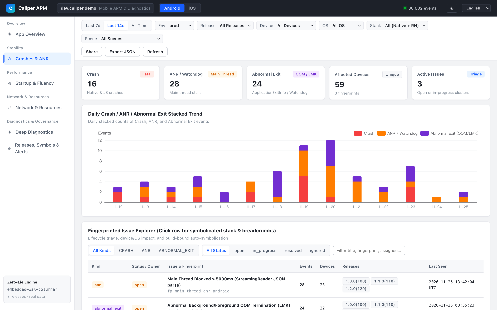
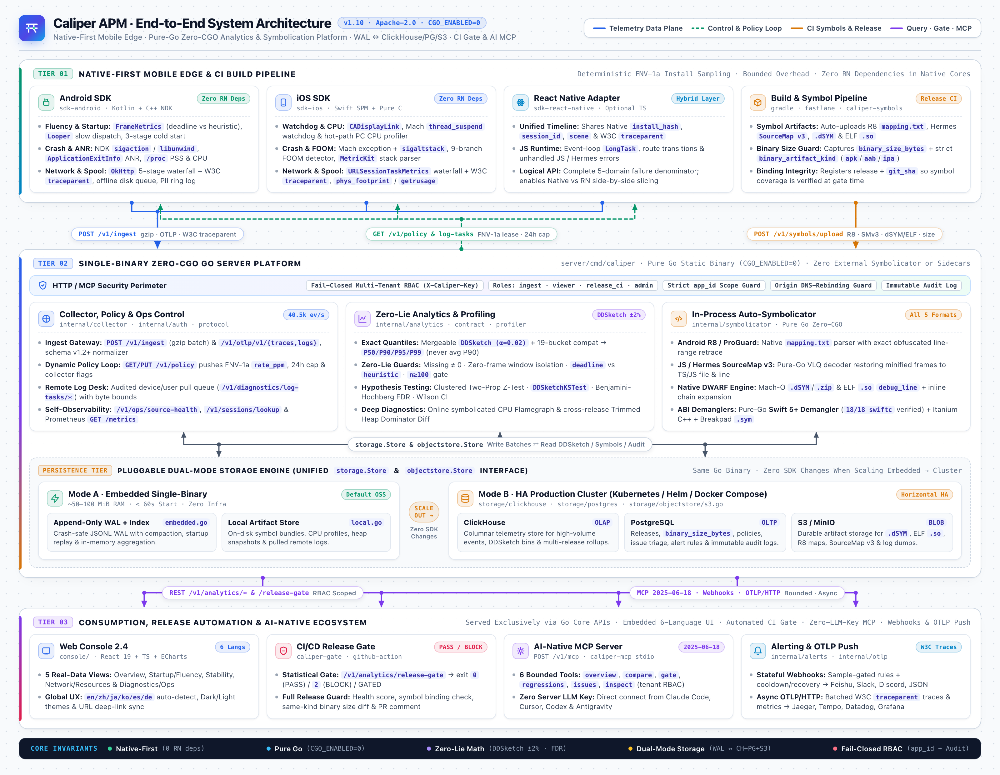

<div align="center">

# Caliper APM

**APM Móvil Open-Source Native-First, Compatible con React Native y Basado en Evidencia (Zero-Lie)**

[](https://caliper-apm.github.io/caliper/?lang=es&theme=dark)
[](LICENSE)
[](https://github.com/caliper-apm/caliper/releases)
[](https://github.com/caliper-apm/caliper/actions/workflows/ci.yml)
[](https://github.com/caliper-apm/caliper/actions/workflows/docker-e2e.yml)
[](server/go.mod)

[English](README.md) · [简体中文](README.zh-CN.md) · [日本語](README.ja.md) · [한국어](README.ko.md) · **Español** · [Deutsch](README.de.md)

**[🚀 Abrir Demo Interactiva](https://caliper-apm.github.io/caliper/?lang=es&theme=dark)** · [Arquitectura](docs/architecture.md) · [Auto-hospedaje](docs/self-hosting.md) · [SDK Android](docs/sdk-android.md) · [SDK iOS](docs/sdk-ios.md) · [Adaptador RN](docs/sdk-react-native.md) · [Benchmarks](benchmarks/REPORT.md) · [Changelog](CHANGELOG.md)

<br />

<a href="https://caliper-apm.github.io/caliper/?lang=es&theme=dark"></a>

*Console 2.4 con datos reales ejecutándose en un único binario Go sin CGO (~15 MiB en reposo / ~69 MiB con 30k eventos): tendencias DDSketch (±2%) P50/P90/P95/P99, marcadores de despliegue, corte Native vs React Native, tema oscuro/claro e interfaz en 6 idiomas.*

</div>

---

## Recorrido Visual de Console 2.4 (100% Datos Reales)

| **Arranque en Frío (3 Fases) y Distribución en 19 Cubetas** | **Red y Recursos (5 Dominios de Fallo + Latencia)** |
| :---: | :---: |
|  |  |
| **Diagnóstico Profundo (Flamegraph CPU y Fugas Heap)** | **Fallos, ANR y Simbolización Automática (Modo Claro)** |
|  |  |

---

## ¿Por qué Caliper APM?

La mayoría de las apps móviles medianas y grandes combinan **código Nativo en flujos críticos (feeds, arranque, red, multimedia)** con **React Native en pantallas de iteración rápida**. Caliper APM resuelve esta brecha con 5 principios:

1. **Núcleo Native-First + Adaptador RN de Primera Clase**: `sdk-android` (Kotlin + NDK) y `sdk-ios` (Swift SPM + C/Mach) tienen **cero dependencias de React Native**. Las apps híbridas conectan `sdk-react-native` al mismo ciclo de vida nativo, trazado W3C `traceparent` y simbolización.
2. **Motor Estadístico Zero-Lie**: **DDSketch ($\alpha = 2\%$)** en Go puro sin dependencias para cuantiles fusionables `P50 / P90 / P95 / P99`, pruebas **`DDSketchKSTest`**, prueba Z agrupada por ventana para fluidez y corrección **Benjamini-Hochberg FDR**. Nunca rellena días faltantes con ceros, aísla ventanas sin frames y exige puertas de muestra (`n >= 100`).
3. **Auto-Simbolización Integrada Sin CGO**: Resuelve **R8/ProGuard**, **Source Map v3 (JS/Hermes)**, **Mach-O `.dSYM` / ELF `.so` DWARF (con expansión inline y demanglers Swift 5+ / Itanium C++)** y **Breakpad `.sym`** dentro del mismo binario Go, sin microservicios externos.
4. **Puerta de Calidad CI/CD y Servidor MCP Nativo para IA**: `caliper-gate` CLI / GitHub Action bloquea automáticamente versiones con regresiones (`PASS` / `BLOCK` / `GATED` + seguimiento de tamaño binario por mismo formato), y el servidor MCP en Go puro (`POST /v1/mcp` + `caliper-mcp`) conecta Cursor, Claude Code, Codex y Antigravity con aislamiento RBAC y **sin claves LLM en el servidor**.
5. **De Un Solo Binario en 60s a Clúster Horizontal**: Comienza con un binario Go (WAL embebido con compactación automática) y escala a **ClickHouse + PostgreSQL HA + S3/MinIO + Kubernetes Helm** sin cambiar una sola línea en tus apps móviles.

---

## Capacidades de los SDK Móviles (Android · iOS · React Native)

| Dominio | Android SDK (Kotlin + C++ NDK · **Cero RN**) | iOS SDK (Swift SPM + `8.4 KiB` C/Mach · **Cero RN**) | Adaptador React Native (TS Opcional) |
|---|---|---|---|
| **Arranque y Fluidez** | Arranque en frío en 3 fases, `FrameMetrics` (`DEADLINE` vs `heuristic`), historial `Looper`, `CaliperWatchdog` | Arranque en 3 fases, `CADisplayLink` (120Hz ProMotion), Watchdog Mach `thread_suspend` sin deadlock | `LongTask` del bucle JS, rutas y comparativa Native vs RN |
| **Crash · ANR · FOOM** | NDK `libcaliper_native.so` (sin `libc++_shared.so`, reenvío `SIGQUIT` ANR) + `ApplicationExitInfo` | Excepción Mach en C + `sigaltstack` + **detector FOOM de 9 ramas** + parser `MetricKit` | Errores JS/Hermes simbolizados con `SourceMap v3` a líneas TS/TSX |
| **Red · CPU · Build** | Cascada `OkHttp` de 5 fases + W3C `traceparent` + plugins Gradle ASM9/R8, `CaliperCpuProfiler` | Proxy transparente `CaliperAutoURLSessionDelegate`, `CaliperIOSCPUProfiler` (Mach PC), SwiftUI `.caliperScene()`, plugin Fastlane `.dSYM`/IPA | `wrapFetchForDenominator` (5 dominios de fallo · **`42 ns` / compresión 550×**) |
| **Seguridad y Coexistencia** | Sin hooks globales frágiles; `CaliperExternalProbeBridge` integra Matrix/KOOM/sondas propias; sampling FNV-1a + cola en disco acotada | Igual: `CaliperExternalProbeBridge`, logs con limpieza automática de PII y extracción remota auditada | Reutiliza la cola offline, lease FNV-1a y `traceparent` del cliente Nativo |

### Integración en Una Línea ([`sdk-android.md`](docs/sdk-android.md) · [`sdk-ios.md`](docs/sdk-ios.md) · [`sdk-react-native.md`](docs/sdk-react-native.md))

```kotlin
// Android (Application.onCreate) — con plugins Gradle ASM9 y R8
CaliperAndroidAgent.install(this, config)
window.decorView.post { CaliperAndroidAgent.markFirstContentFrame() }
```

```swift
// iOS (SwiftPM) — compatible con SwiftUI .caliperScene() y proxy URLSession
let client = CaliperIOSAgent.install(config: config)
CaliperIOSAgent.markFirstContentFrame()
```

```ts
// React Native — reducción 550× del puente y denominador API de 5 dominios
globalThis.fetch = wrapFetchForDenominator(globalThis.fetch, caliperRN, { allowHosts: ['api.example.com'] });
caliperRN.setScene('home_feed');
```

---

## Arquitectura del Sistema

<p align="center">
  <picture>
    <source media="(prefers-color-scheme: dark)" srcset="docs/assets/architecture-dark.png" />
    <source media="(prefers-color-scheme: light)" srcset="docs/assets/architecture-light.png" />
    
  </picture>
</p>

- **Plano de Datos y Bucle de Control**: Los SDK móviles envían telemetría comprimida (`POST /v1/ingest`, W3C `traceparent`) mientras reciben políticas deterministas FNV-1a (`GET /v1/policy`) y tareas acotadas de extracción remota de logs; el pipeline CI sube símbolos y el tamaño binario (`binary_size_bytes`).
- **Motor Go Todo-en-Uno Sin CGO**: `server/cmd/caliper` (`CGO_ENABLED=0`) unifica RBAC multi-tenant fail-closed, analítica estadística Zero-Lie (`DDSketch ±2%`, Z-Test agrupado, KS y FDR) y simbolización en proceso para 5 formatos (R8, SourceMap v3, Mach-O `.dSYM`/ELF `.so` DWARF, Swift 5+ / C++, Breakpad) sin microservicios externos.
- **Almacenamiento Dual Intercambiable**: Inicia en < 60 s con WAL embebido (~50–100 MiB RAM) o escala horizontalmente a **ClickHouse + PostgreSQL + S3/MinIO** sin tocar una línea en tus SDKs, alimentando Console 2.4, `caliper-gate`, MCP (`2025-06-18`), webhooks y exportación OTLP/HTTP.

---

## Inicio Rápido (< 1 Minuto)

### Docker Compose (Recomendado)
```bash
git clone https://github.com/caliper-apm/caliper.git
cd caliper
docker compose up --build
# Abre http://localhost:8080 — precargado con v1.0.0 -> v1.1.0 (regresión) -> v1.2.0 (corregida)
```

### Arranque Local sin Docker (Go 1.23+ y Node 22+)
```bash
./scripts/dev-quickstart.sh
```

### Integración con Agentes de Código IA (Cursor / Claude Code / Codex / Antigravity)
```json
{
  "mcpServers": {
    "caliper-apm": {
      "command": "caliper-mcp",
      "args": ["--server", "http://127.0.0.1:8080"],
      "env": { "CALIPER_API_KEY": "${CALIPER_VIEWER_KEY}" }
    }
  }
}
```

---

## Benchmarks Reales en Dispositivos Físicos (Release OFF vs ON)

Metodología completa y distribuciones reales en [`benchmarks/REPORT.md`](benchmarks/REPORT.md).

| Plataforma / Componente | Carga de Prueba (Release OFF vs ON) | Resultado Medido |
|---|---|---|
| **Android Físico (`vivo V2343A`, API 34, AOT)** | 20 arranques en frío + 15 scrolls + PSS + APK | Arranque **`+6.0 ms` P50** · Jank **`+0.00%`** · PSS **`+2.67 MiB`** · APK **`+28.0 KiB`** · Crashes **`0`** |
| **iOS Físico (`iPhone 13 Pro Max`, `-O`)** | 18 arranques en frío + ProMotion + `phys_footprint` | Arranque **`+3.98 ms` P50** · Jank **`+0.00%`** · Memoria **`+0.34 MiB`** · CPU **`+0.10%`** · Binario **`+247.5 KiB`** |
| **Servidor Go (Binario Único + WAL)** | Replay Gzip de 30,002 eventos + comparación | **40,489 events/s** · Comparación **1.55–2.47 ms** · RSS **15.2 → 69.0 MiB** |
| **Adaptador RN (`sdk-react-native`)** | 100k llamadas API + 10k LongTasks | **42 ns / API** · **Reducción 550× del tráfico de bridge** |

---

## Licencia

Distribuido bajo licencia [Apache License 2.0](LICENSE).
