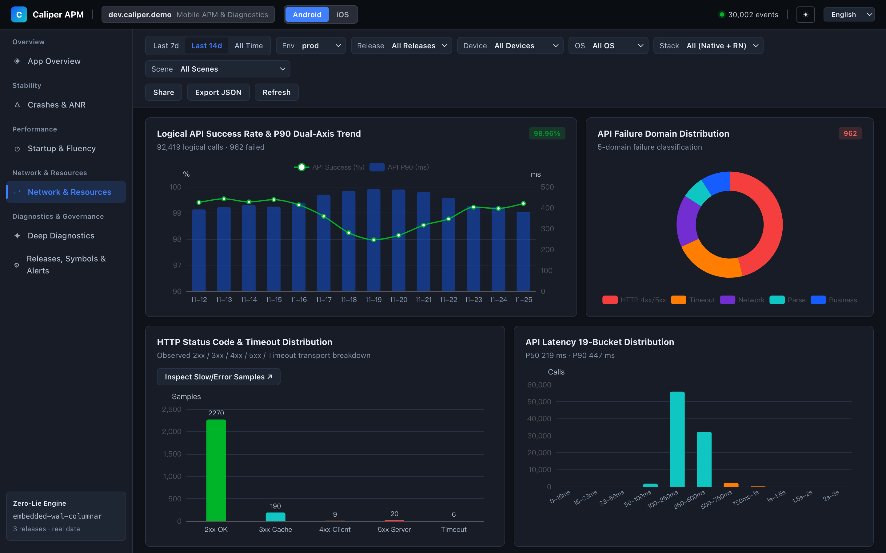
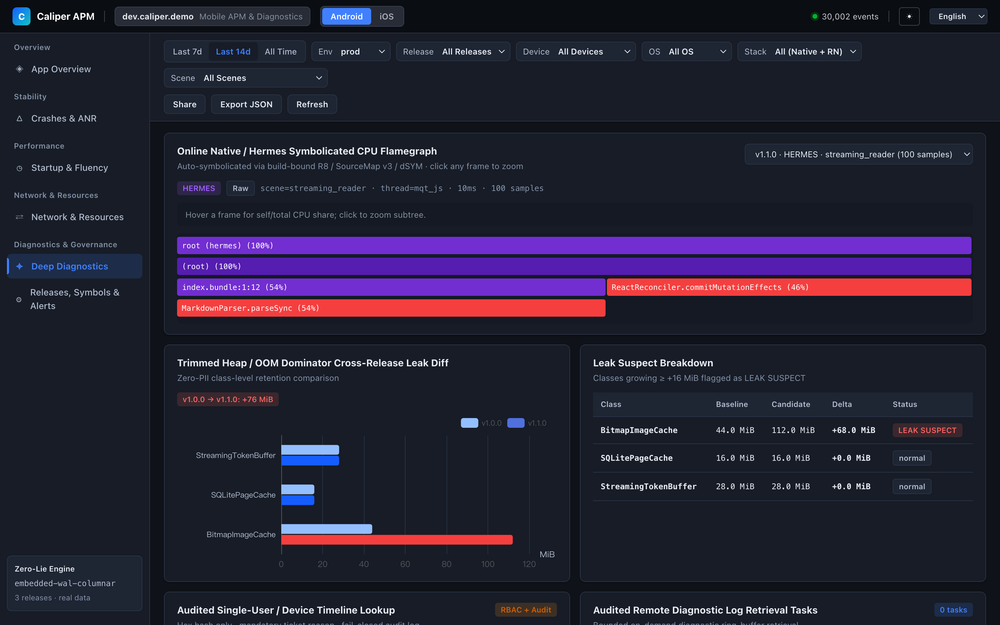

<div align="center">

# Caliper APM

**Native ファースト・React Native 一級対応・統計ゼロ虚偽（Zero-Lie）のオープンソース・モバイル APM プラットフォーム**

[](LICENSE)
[](https://github.com/caliper-apm/caliper/releases)
[](https://github.com/caliper-apm/caliper/actions/workflows/ci.yml)
[](https://github.com/caliper-apm/caliper/actions/workflows/docker-e2e.yml)
[](server/go.mod)

[English](README.md) · [简体中文](README.zh-CN.md) · **日本語** · [한국어](README.ko.md) · [Español](README.es.md) · [Deutsch](README.de.md)

[アーキテクチャ](docs/architecture.md) · [セルフホスト](docs/self-hosting.md) · [Android SDK](docs/sdk-android.md) · [iOS SDK](docs/sdk-ios.md) · [RN アダプター](docs/sdk-react-native.md) · [実測ベンチマーク](benchmarks/REPORT.md) · [更新履歴](CHANGELOG.md)

<br />


*ゼロ CGO 単一 Go バイナリ（待機 ~15 MiB / 3 万イベント ~69 MiB）で動作する実データ Console 2.4。DDSketch（±2%）P50/P90/P95/P99 推移、リリース切替マーカー、Native vs React Native 比較、ダーク/ライトテーマ、6 言語 UI を搭載。*

</div>

---

## Console 2.4 スクリーンショット（100% 実データ）

| **コールド起動 3 段階 & 19 バケット遅延分布** | **ネットワーク監視（5 ドメイン失敗分類 & 遅延分布）** |
| :---: | :---: |
|  |  |
| **詳細診断（CPU フレームグラフ & ヒープリーク差分）** | **クラッシュ・ANR 推移 & イシュー管理（ライトモード）** |
|  |  |

---

## なぜ Caliper APM なのか？

中〜大規模モバイルアプリの多くは、**コア体験（フィード・起動・通信・動画）を Native で実装し、高頻度変更画面を React Native で実装**しています。Caliper APM は以下の 5 つの設計原則で既存ツールの断絶を解消します：

1. **Native ファースト + RN 一級アダプター**：`sdk-android`（Kotlin + NDK）および `sdk-ios`（Swift SPM + C/Mach）は **React Native 依存ゼロ**。ハイブリッドアプリでは `sdk-react-native` を同じ Native ライフサイクル・W3C `traceparent`・シンボル化タイムラインに統合します。
2. **Zero-Lie 統計分析エンジン**：純 Go ゼロ依存の **DDSketch（$\alpha = 2\%$）** による可合算 `P50 / P90 / P95 / P99`、**`DDSketchKSTest`** によるバケット内回帰検出、フレーム相関誤検知を防ぐ**ウィンドウクラスタ Z 検定**、**Benjamini-Hochberg FDR** 多重検定補正を内蔵。欠損日ゼロ補完なし・ゼロフレーム隔離・サンプル数ゲート（`n >= 100`）を厳守します。
3. **純 Go ゼロ CGO 内蔵自動シンボル化**：外部 Symbolicator サービス不要で **R8/ProGuard**、**Source Map v3（JS/Hermes）**、**Mach-O `.dSYM` / Android ELF `.so` DWARF（インライン展開・Swift 5+ & Itanium C++ Demangler）**、**Breakpad `.sym`** をプロセス内で自動復元します。
4. **CI/CD 統計リリースゲート & AI ネイティブ MCP Server**：`caliper-gate` CLI / GitHub Action による自動カナリア遮断（`PASS` / `BLOCK` / `GATED` + 同一形式バイナリサイズ比較）と、**サーバー側 LLM キー不要**・RBAC テナント隔離済みの純 Go MCP Server（`POST /v1/mcp` + `caliper-mcp`）を搭載。
5. **1 分で動く単一バイナリ → クラスター水平拡張**：開発機では 1 つの Go バイナリ（Embedded WAL 圧縮対応）で即起動し、本番規模では SDK コード無変更のまま **ClickHouse + PostgreSQL HA + S3/MinIO + Kubernetes Helm** へ拡張できます。

---

## クイックスタート（1 分以内）

### Docker Compose（推奨）
```bash
git clone https://github.com/caliper-apm/caliper.git
cd caliper
docker compose up --build
# http://localhost:8080 を開くと v1.0.0 -> v1.1.0（劣化）-> v1.2.0（改善）の 14 日間実データが表示されます
```

### ローカル ゼロ Docker 起動（Go 1.23+ & Node 22+）
```bash
./scripts/dev-quickstart.sh
```

### AI コーディングエージェント連携（Cursor / Claude Code / Codex / Antigravity）
```json
{
  "mcpServers": {
    "caliper-apm": {
      "command": "caliper-mcp",
      "args": ["--server", "http://127.0.0.1:8080"],
      "env": { "CALIPER_API_KEY": "${CALIPER_VIEWER_KEY}" }
    }
  }
}
```

---

## 実機ベンチマーク（Release ビルド OFF vs ON）

詳細な検証手順と生データ：[`benchmarks/REPORT.md`](benchmarks/REPORT.md)

| プラットフォーム / コンポーネント | 検証条件（Release OFF vs ON） | 実測結果 |
|---|---|---|
| **Android 実機（`vivo V2343A`, API 34, AOT）** | コールド起動 20 回 + スクロール 15 回 + PSS + APK | コールド起動 **`+6.0 ms` P50** · ジャンク **`+0.00%`** · PSS **`+2.67 MiB`** · APK **`+28.0 KiB`** · 自クラッシュ **`0`** |
| **iOS 実機（`iPhone 13 Pro Max`, `-O`）** | コールド起動 18 回 + ProMotion 計測 + `phys_footprint` | コールド起動 **`+3.98 ms` P50** · ジャンク **`+0.00%`** · メモリ **`+0.34 MiB`** · CPU **`+0.10%`** · バイナリ **`+247.5 KiB`** |
| **Go サーバー（単一バイナリ + WAL）** | 30,002 イベント Gzip 回放 + 統計比較 | **40,489 events/s** · 比較応答 **1.55–2.47 ms** · RSS **15.2 → 69.0 MiB** |
| **RN アダプター（`sdk-react-native`）** | 10 万回 API + 1 万回 LongTask | **42 ns / API** · **ブリッジ通信 550× 削減** |

---

## ライセンス

[Apache License 2.0](LICENSE) の下でオープンソース公開されています。
