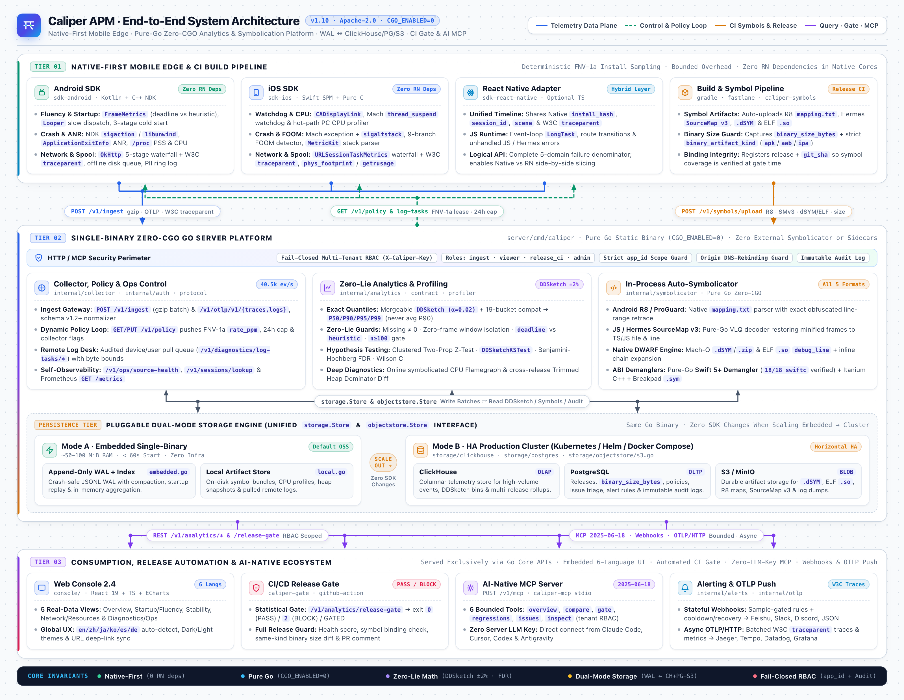

<div align="center">

# Caliper APM

**Native 우선 · React Native 일급 호환 · 통계 무결성(Zero-Lie) 오픈소스 모바일 APM 플랫폼**

[](LICENSE)
[](https://github.com/caliper-apm/caliper/releases)
[](https://github.com/caliper-apm/caliper/actions/workflows/ci.yml)
[](https://github.com/caliper-apm/caliper/actions/workflows/docker-e2e.yml)
[](server/go.mod)

[English](README.md) · [简体中文](README.zh-CN.md) · [日本語](README.ja.md) · **한국어** · [Español](README.es.md) · [Deutsch](README.de.md)

[아키텍처](docs/architecture.md) · [셀프 호스팅](docs/self-hosting.md) · [Android SDK](docs/sdk-android.md) · [iOS SDK](docs/sdk-ios.md) · [RN 어댑터](docs/sdk-react-native.md) · [실측 벤치마크](benchmarks/REPORT.md) · [변경 이력](CHANGELOG.md)

<br />


*제로 CGO 단일 Go 바이너리(유휴 ~15 MiB / 3만 이벤트 ~69 MiB)로 구동되는 실데이터 Console 2.4. DDSketch(±2%) P50/P90/P95/P99 추이, 릴리즈 롤아웃 마커, Native vs React Native 비교, 다크/라이트 테마 및 6개국어 UI 지원.*

</div>

---

## Console 2.4 스크린샷 (100% 실제 수집 데이터)

| **콜드 스타트 3단계 & 19버킷 지연 분포** | **네트워크 모니터링 (5대 실패 도메인 & 지연 분포)** |
| :---: | :---: |
|  |  |
| **심층 진단 (CPU 플레임그래프 & 힙 누수 비교)** | **크래시 · ANR 추이 및 이슈 관리 (라이트 모드)** |
|  |  |

---

## 왜 Caliper APM인가요?

대부분의 중대형 모바일 앱은 **핵심 성능 경로(피드·실행·네트워크·미디어)를 Native로, 빠른 비즈니스 화면을 React Native로** 운영합니다. Caliper APM은 5가지 핵심 원칙으로 모바일 관측의 빈틈을 메웁니다:

1. **Native 우선 코어 + RN 일급 어댑터**: `sdk-android`(Kotlin + NDK)와 `sdk-ios`(Swift SPM + C/Mach)는 **React Native 의존성 0**. 하이브리드 앱에서는 `sdk-react-native`를 동일한 Native 수명 주기, W3C `traceparent`, 심볼릭 타임라인에 통합합니다.
2. **Zero-Lie 통계 엔진**: 순수 Go 무의존 **DDSketch($\alpha = 2\%$)** 기반 병합 가능 `P50 / P90 / P95 / P99`, **`DDSketchKSTest`** 버킷 내부 회귀 탐지, 프레임 자기상관 오탐 방지 **윈도우 클러스터 Z-검정**, **Benjamini-Hochberg FDR** 다중검정 보정을 내장했습니다. 누락일 0 보정 금지 · 제로프레임 격리 · 최소 표본 게이트(`n >= 100`)를 엄격히 준수합니다.
3. **순수 Go 제로 CGO 내장 자동 심볼화**: 별도 Symbolicator 서버 없이 **R8/ProGuard**, **Source Map v3(JS/Hermes)**, **Mach-O `.dSYM` / Android ELF `.so` DWARF(인라인 전개 · Swift 5+ & Itanium C++ Demangler)**, **Breakpad `.sym`**을 프로세스 내에서 즉시 복원합니다.
4. **CI/CD 통계 릴리즈 게이트 & AI 네이티브 MCP Server**: `caliper-gate` CLI / GitHub Action으로 회귀 버전 배포를 자동 차단(`PASS` / `BLOCK` / `GATED` + 동일 포맷 바이너리 크기 비교)하며, **서버 측 LLM 키가 필요 없는** RBAC 멀티테넌트 격리 순수 Go MCP Server(`POST /v1/mcp` + `caliper-mcp`)를 제공합니다.
5. **1분 단일 바이너리 시작 → 클러스터 수평 확장**: 노트북에서는 단일 Go 바이너리(WAL 자동 압축)로 즉시 시작하고, 프로덕션에서는 SDK 수정 없이 **ClickHouse + PostgreSQL HA + S3/MinIO + Kubernetes Helm**으로 확장합니다.

---

## 모바일 SDK 핵심 기능 매트릭스 (Android · iOS · React Native)

| 영역 | Android SDK (Kotlin + C++ NDK · **RN 의존성 0**) | iOS SDK (Swift SPM + `8.4 KiB` C/Mach · **RN 의존성 0**) | React Native 어댑터 (선택 TS) |
|---|---|---|---|
| **콜드 스타트 & 프레임** | 3단계 콜드 스타트, `FrameMetrics`(`DEADLINE`/`heuristic` 격리), `Looper` 지연 이력, `CaliperWatchdog` | 3단계 콜드 스타트, `CADisplayLink`(120Hz ProMotion), Mach `thread_suspend` Watchdog | JS Event-Loop `LongTask`, 라우트 전환, Native vs RN 슬라이싱 |
| **크래시 · ANR · FOOM** | NDK `libcaliper_native.so`(`libc++_shared.so` 무의존, `SIGQUIT` ANR 전달) + `ApplicationExitInfo` | 순수 C Mach 예외 + `sigaltstack` + **9분기 FOOM 상태 머신** + `MetricKit` 파서 | 미처리 JS/Hermes 에러 + Hermes `SourceMap v3` 자동 심볼 복원 |
| **네트워크 · CPU · 빌드** | `OkHttp` 5단계 워터폴 + W3C `traceparent` + Gradle ASM9/R8 플러그인, `CaliperCpuProfiler` | `CaliperAutoURLSessionDelegate` 투과 프록시, `CaliperIOSCPUProfiler`(Mach PC 샘플링), SwiftUI `.caliperScene()`, Fastlane `.dSYM`/IPA 플러그인 | `wrapFetchForDenominator`(5대 실패 도메인 분모 · **`42 ns` / 550× 브리지 압축**) |
| **안전 가드 & 공존** | 위험한 전역 Hook 배제, `CaliperExternalProbeBridge`로 Matrix/KOOM 등 기존 프로브 연동, FNV-1a 리스 + 유한 디스크 큐 | 동일: `CaliperExternalProbeBridge` 내장, PII 자동 마스킹 링 로그 + 감사 원격 로그 수집 | Native `CaliperClient`의 샘플링 리스 · 디스크 큐 · `traceparent` 공유 |

### 한 줄 모바일 SDK 연동 (상세: [`sdk-android.md`](docs/sdk-android.md) · [`sdk-ios.md`](docs/sdk-ios.md) · [`sdk-react-native.md`](docs/sdk-react-native.md))

```kotlin
// Android (Application.onCreate) — Gradle ASM9/R8 플러그인 지원
CaliperAndroidAgent.install(this, config)
window.decorView.post { CaliperAndroidAgent.markFirstContentFrame() }
```

```swift
// iOS (SwiftPM) — SwiftUI .caliperScene() & URLSession 투과 프록시 지원
let client = CaliperIOSAgent.install(config: config)
CaliperIOSAgent.markFirstContentFrame()
```

```ts
// React Native — 550× 브리지 압축 & 5대 실패 도메인 API 분모
globalThis.fetch = wrapFetchForDenominator(globalThis.fetch, caliperRN, { allowHosts: ['api.example.com'] });
caliperRN.setScene('home_feed');
```

---

## 시스템 아키텍처

<p align="center">
  <picture>
    <source media="(prefers-color-scheme: dark)" srcset="docs/assets/architecture-dark.png" />
    <source media="(prefers-color-scheme: light)" srcset="docs/assets/architecture-light.png" />
    
  </picture>
</p>

- **데이터 플레인 & 컨트롤 루프 분리**: 모바일 SDK는 gzip 배치 텔레메트리(`POST /v1/ingest`, W3C `traceparent`)를 전송하고, FNV-1a 결정론적 샘플링 리스(`GET /v1/policy`)와 원격 로그 수집 작업을 제어 루프로 수신합니다.
- **순수 Go 제로 CGO 올인원 엔진**: 단일 바이너리(`CGO_ENABLED=0`) 안에서 Fail-Closed 멀티테넌트 RBAC, Zero-Lie `DDSketch (±2%)` 통계·프로파일링 엔진, 5종 포맷 프로세스 내 심볼라이저(R8, SourceMap v3, Mach-O `.dSYM`/ELF `.so` DWARF, Swift 5+ / C++, Breakpad)를 사이드카 없이 실행합니다.
- **듀얼 모드 스토리지 & 확장 생태계**: 단일 바이너리 Embedded WAL(~50–100 MiB RAM)에서 SDK 변경 없이 **ClickHouse + PostgreSQL + S3/MinIO** 클러스터로 수평 확장하며, Console 2.4 · `caliper-gate` · AI MCP(`2025-06-18`) · 알림 Webhook · OTLP 푸시를 통합 제공합니다.

---

## 빠른 시작 (1분 이내)

### Docker Compose (권장)
```bash
git clone https://github.com/caliper-apm/caliper.git
cd caliper
docker compose up --build
# http://localhost:8080 접속 시 v1.0.0 -> v1.1.0(회귀) -> v1.2.0(복구) 14일 시나리오 즉시 확인
```

### 로컬 Docker 없이 실행 (Go 1.23+ & Node 22+)
```bash
./scripts/dev-quickstart.sh
```

### AI 코딩 에이전트 연동 (Cursor / Claude Code / Codex / Antigravity)
```json
{
  "mcpServers": {
    "caliper-apm": {
      "command": "caliper-mcp",
      "args": ["--server", "http://127.0.0.1:8080"],
      "env": { "CALIPER_API_KEY": "${CALIPER_VIEWER_KEY}" }
    }
  }
}
```

---

## 실기기 벤치마크 (Release 빌드 OFF vs ON)

전체 방법론 및 원본 수치: [`benchmarks/REPORT.md`](benchmarks/REPORT.md)

| 플랫폼 / 구성 요소 | 테스트 조건 (Release OFF vs ON) | 실측 결과 |
|---|---|---|
| **Android 실기기 (`vivo V2343A`, API 34, AOT)** | 콜드 스타트 20회 + 스크롤 15회 + PSS + APK | 콜드 스타트 **`+6.0 ms` P50** · Jank **`+0.00%`** · PSS **`+2.67 MiB`** · APK **`+28.0 KiB`** · 자체 크래시 **`0`** |
| **iOS 실기기 (`iPhone 13 Pro Max`, `-O`)** | 콜드 스타트 18회 + ProMotion 스크롤 + `phys_footprint` | 콜드 스타트 **`+3.98 ms` P50** · Jank **`+0.00%`** · 메모리 **`+0.34 MiB`** · CPU **`+0.10%`** · 바이너리 **`+247.5 KiB`** |
| **Go 서버 (단일 바이너리 + WAL)** | 30,002건 Gzip 리플레이 + 릴리즈 통계 비교 | **40,489 events/s** · 비교 응답 **1.55–2.47 ms** · RSS **15.2 → 69.0 MiB** |
| **RN 어댑터 (`sdk-react-native`)** | 10만 API 호출 + 1만 LongTask | **42 ns / API** · **브리지 호출 550× 절감** |

---

## 라이선스

[Apache License 2.0](LICENSE)으로 공개되어 있습니다.
