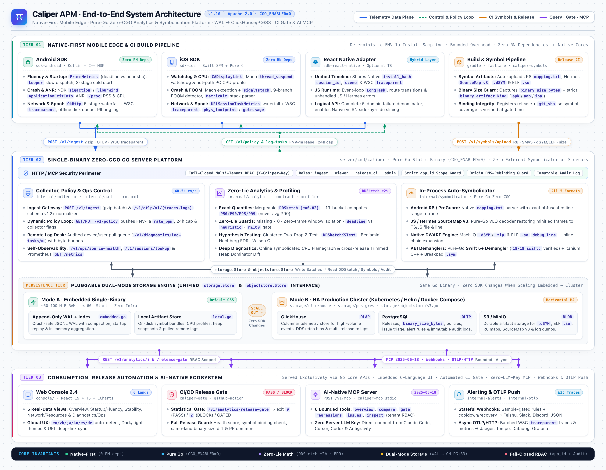

<div align="center">

# Caliper APM

**Open-source mobile APM built for mobile engineers: Native-first SDKs, first-class React Native fusion, ultra-low measured Release overhead, and Zero-Lie statistical release gating.**

[](LICENSE)
[](https://github.com/caliper-apm/caliper/releases)
[](https://github.com/caliper-apm/caliper/actions/workflows/ci.yml)
[](https://github.com/caliper-apm/caliper/actions/workflows/docker-e2e.yml)
[](server/go.mod)

**English** · [简体中文](README.zh-CN.md) · [日本語](README.ja.md) · [한국어](README.ko.md) · [Español](README.es.md) · [Deutsch](README.de.md)

[Android SDK](docs/sdk-android.md) · [iOS SDK](docs/sdk-ios.md) · [RN Adapter](docs/sdk-react-native.md) · [Device Benchmarks](benchmarks/REPORT.md) · [Architecture](docs/architecture.md) · [Self-Hosting](docs/self-hosting.md) · [Changelog](CHANGELOG.md)

<br />


*Live Console 2.4 running on a single zero-CGO Go binary (~15 MiB idle / ~69 MiB at 30k events) with DDSketch (±2%) P50/P90/P95/P99 trends, release rollout markers, Native vs RN slicing, Dark/Light themes, and 6 languages.*

</div>

---

## Console 2.4 Visual Tour (100% Real Ingested Data)

| **3-Stage Cold Start & 19-Bucket Latency Histogram** | **Network Intelligence (5-Domain Failure Donut & Latency)** |
| :---: | :---: |
|  |  |
| **Deep Diagnostics (CPU Flamegraph & Heap Dominator Diff)** | **Crash / ANR Stacked Trend & Issue Triage (Light Mode)** |
|  |  |

---

## Why Mobile Teams Choose Caliper APM

Most mid-to-large mobile apps run a **hybrid architecture**: **Native** powers performance-critical paths (cold start, home feeds, media, low-level networking) while **React Native** powers rapidly iterating product screens. Mobile engineers usually get stuck between three broken options:

- **Client-only diagnostic libraries (Matrix / KOOM / xCrash)** capture rich local signals but lack a telemetry backend, cross-release statistical comparison, automatic symbolication, alerting, and CI release gating.
- **Heavy general-purpose observability stacks** demand 16–32 GB RAM and 10+ containers while missing mobile-specific semantics like Android `FrameMetrics` algorithm separation, iOS 9-branch FOOM detection, 3-stage cold-start conservation, and RN bridge traffic compression.
- **Closed-source SaaS APMs** are expensive black boxes that quietly average daily P90s or count zero-frame windows as 0% jank.

**Caliper APM** gives mobile teams **Native-first, bounded-overhead SDKs** backed by a **single-binary Zero-CGO Go engine** that turns client telemetry into statistically honest release decisions.

---

## Mobile SDK Capabilities Matrix (Android · iOS · React Native)

| Domain | Android SDK (Kotlin + C++ NDK · **Zero RN Deps**) | iOS SDK (Swift SPM + `8.4 KiB` Pure C/Mach · **Zero RN Deps**) | React Native Adapter (Optional TS) |
|---|---|---|---|
| **3-Stage Cold Start** | `Process.getStartElapsedRealtime` → `Application.onCreate` → first content frame (`native + runtime + first_frame <= total`) | Process start time → bootstrap → `markFirstContentFrame()` monotonic split | Attaches to Native cold start; tracks RN route first-render & multi-stage journeys |
| **Fluency & Hangs** | Background `HandlerThread` `FrameMetrics` (API 31+ `DEADLINE` strictly isolated from API 26–30 `heuristic`), zero-frame isolation, main-thread `Looper` slow-dispatch + 20-msg history, `CaliperWatchdog` | `CADisplayLink` (120Hz ProMotion ready), background Mach `thread_suspend` + `vm_read_overwrite` real main-thread hang stack capture (never self-deadlocks) | JS Event-Loop `LongTask` window aggregation correlated with Native fluency windows |
| **Crash / ANR / FOOM** | Chained Java handler + NDK `libcaliper_native.so` (**zero `libc++_shared.so`**, `sigaltstack` + `_Unwind_Backtrace` + `SIGQUIT` ANR forwarder) + API 30+ `ApplicationExitInfo` | Pure C Mach Exception + `sigaltstack` + corrupted-FP safe unwinder + **9-branch Foreground OOM (FOOM) state machine** + `MetricKit` callstack tree parser | Unhandled JS / Hermes error capture auto-symbolicated via Hermes `SourceMap v3` to original TS/TSX lines |
| **Network & Distributed Tracing** | `OkHttp` 5-stage waterfall (DNS / TCP / TLS / TTFB / Body + reuse) + allowlisted W3C `traceparent` + **Gradle ASM9 zero-boilerplate weaving** | `CaliperAutoURLSessionDelegate` transparent forwarding proxy (preserves SSL pinning & auth) + `URLSessionTaskMetrics` waterfall + W3C `traceparent` | `wrapFetchForDenominator` full 5-domain failure denominator (`42 ns/call`, **550× bridge traffic reduction**) |
| **CPU Profiling & Specialty Probes** | `CaliperCpuProfiler` Java stack sampler, `/proc` PSS/CPU, thermal/battery, zero-PII disk audit, WebView blank-screen/FCP, `@CaliperTrace` journeys | `CaliperIOSCPUProfiler` (hot-path zero-`dladdr` Mach PC sampler), `phys_footprint` / `getrusage`, thermal, disk audit, `WKWebView` probe, SwiftUI `.caliperScene()` | `recordCustomJourney` multi-stage flows; one-click **Native vs RN** slicing in Console 2.4 |
| **Build Plugins & Symbolication** | Gradle `io.caliper.apm.autoinstrument` & `io.caliper.apm.symbols` (verified on **AGP 8.7.3 + R8 8.7.18 + NDK 27**) | Fastlane `.dSYM` + IPA size plugin; pure-Go in-process Mach-O DWARF inline expansion + **Swift 5+ / Itanium C++ Demangler** | `caliper-symbols` uploads Hermes `.map` bundles; pure-Go VLQ decoder |

---

## Verified Physical-Device Release Overhead (2026-11-23)

Before shipping any APM SDK to production, mobile teams ask four questions: *Does it slow cold start? Drop frames? Bloat the binary? Ever crash the app?* Full methodology and raw distributions live in [`benchmarks/REPORT.md`](benchmarks/REPORT.md) (reproducible via `./benchmarks/collect-device-bench.sh`):

| Platform / Component | Release OFF vs ON Workload | Measured Delta |
|---|---|---|
| **Android Physical (`vivo V2343A`, Android 14 / AOT)** | 20 cold starts + 15-fling scroll + `TOTAL PSS` + APK | Cold Start **`+6.0 ms` P50 (`-1 ms` P95)** · Jank **`+0.00%`** · PSS **`+2.67 MiB`** · APK **`+28.0 KiB`** · Self-Crashes **`0 / 26`** |
| **iOS Physical (`iPhone 13 Pro Max`, 120Hz ProMotion, `-O`)** | 18 cold starts + 3×3s scroll + `phys_footprint` + Mach-O | Cold Start **`+3.98 ms` P50 (`+1.51 ms` P90)** · Jank **`+0.00%`** · Memory **`+0.34 MiB`** · CPU **`+0.10%`** · Binary **`+247.5 KiB`** · Self-Crashes **`0 / 20`** |
| **RN Adapter (`sdk-react-native`)** | 100k API calls + 10k LongTasks | **`42 ns / API call`** · **`550×`** bridge traffic reduction |
| **Go Single-Binary Server + Chaos Lab E2E** | 99,996-event gzip WAL replay + 3-platform symbolication + Webhooks | **`33.6k–76.9k events/s`** · release compare **`0.17–0.90 ms`** · full E2E **`2.74–2.96 s`** |

---

## 3-Minute Mobile SDK Integration

### 1. Android (Pure Kotlin, Zero RN Dependencies · [`docs/sdk-android.md`](docs/sdk-android.md))

One call in `Application.onCreate` wires 3-stage cold start, `FrameMetrics` fluency, NDK + Java crash capture, ANR/Looper tracing, resource sampling, disk audit, and remote log polling:

```kotlin
class MyApp : Application() {
    override fun onCreate() {
        super.onCreate()
        val config = CaliperConfig(
            endpointUrl = "https://apm.example.com",
            apiKey = BuildConfig.CALIPER_INGEST_KEY,
            resource = ResourceIdentity(
                appId = packageName,
                appVersion = BuildConfig.VERSION_NAME,
                buildNumber = BuildConfig.VERSION_CODE.toString(),
                gitSha = BuildConfig.GIT_SHA,
                installHash = InstallationHash.stableHex16(this), // Non-PII 16-64 hex
            ),
            tracePropagationTargets = listOf(".example.com"), // Allowlisted W3C traceparent
        )
        CaliperAndroidAgent.install(this, config)
    }
}

// Mark first meaningful content frame in your launch Activity:
window.decorView.post { CaliperAndroidAgent.markFirstContentFrame() }
```

Enable **zero-boilerplate Gradle ASM9 bytecode weaving (`OkHttp` + `@CaliperTrace`) + automated R8 symbol uploads** in `app/build.gradle.kts`:

```kotlin
plugins {
    id("io.caliper.apm.autoinstrument")
    id("io.caliper.apm.symbols")
}
caliperAutoInstrument {
    enabled.set(true)
    instrumentOkHttp.set(true)       // Auto-hooks OkHttpClient.Builder -> waterfall + W3C traceparent
    instrumentCaliperTrace.set(true) // Auto-times @CaliperTrace methods
    includePackages.set(listOf("com.example.app"))
}
caliperSymbols {
    serverUrl.set("https://apm.example.com")
    apiKey.set(providers.environmentVariable("CALIPER_API_KEY"))
    appId.set("com.example.app")
}
```

### 2. iOS (Pure SwiftPM, Zero RN / Third-Party Dependencies · [`docs/sdk-ios.md`](docs/sdk-ios.md))

Add `packages/sdk-ios` via Swift Package Manager and install in one line — wiring the `8.4 KiB` C/Mach crash core, 9-branch FOOM state machine, Mach watchdog, MetricKit, UIViewController scene tracking, thermal observer, and daily disk audit:

```swift
import CaliperSDK

let config = CaliperConfig(
    endpointURL: URL(string: "https://apm.example.com")!,
    apiKey: ProcessInfo.processInfo.environment["CALIPER_INGEST_KEY"],
    resource: ResourceIdentity(
        appID: Bundle.main.bundleIdentifier ?? "com.example.app",
        appVersion: Bundle.main.infoDictionary?["CFBundleShortVersionString"] as? String ?? "1.0.0",
        buildNumber: Bundle.main.infoDictionary?["CFBundleVersion"] as? String ?? "1",
        installHash: InstallationHash.stableHex16()
    ),
    tracePropagationTargets: [".example.com"]
)
let client = CaliperIOSAgent.install(config: config)

// Launch first-frame marker / SwiftUI scene / SSL-pinning-safe URLSession proxy:
CaliperIOSAgent.markFirstContentFrame()
// SwiftUI: RootView().caliperScene("home_feed")
// Network: let session = CaliperAutoURLSessionDelegate.makeSession(client: client, forwardingTo: myDelegate)
// WKWebView: CaliperWKWebViewBridge.attach(to: webView.configuration.userContentController, client: client)
```

Upload `.dSYM` + exact IPA byte size automatically in `Fastfile`:

```ruby
caliper_upload_symbols(
  server_url: "https://apm.example.com",
  api_key: ENV["CALIPER_API_KEY"],
  app_id: "com.example.app",
  app_version: get_version_number,
  build_number: get_build_number,
  kind: "dsym",
  symbol_path: lane_context[SharedValues::DSYM_OUTPUT_PATH],
  binary_path: lane_context[SharedValues::IPA_OUTPUT_PATH] # Tracks exact IPA bytes with zero SDK overhead
)
```

### 3. React Native Hybrid Adapter (Optional TS Layer · [`docs/sdk-react-native.md`](docs/sdk-react-native.md))

Mounts onto the Native `CaliperClient` so sampling leases, offline queues, W3C `traceparent`, and device identity are never duplicated across JS and Native:

```ts
import { CaliperRNAdapter, wrapFetchForDenominator } from '@caliper-apm/react-native';
import { NativeModules } from 'react-native';

export const caliperRN = new CaliperRNAdapter({
  setScene: (scene) => NativeModules.CaliperRNBridge.setScene(scene),
  enqueueEvent: (kind, scene, windowId, payloadJson) =>
    NativeModules.CaliperRNBridge.enqueueEvent(kind, scene, windowId, payloadJson),
});

// 1. Aggregate logical API calls across 5 failure domains in JS memory (550x bridge reduction)
globalThis.fetch = wrapFetchForDenominator(globalThis.fetch, caliperRN, {
  allowHosts: ['api.example.com'],
});
// 2. Align scene transitions with Native windows & flush per window
caliperRN.setScene('streaming_reader');
setInterval(() => caliperRN.flushWindow(), 30_000);
```

### 4. CI Symbol & Binary Size Upload (`r8_mapping` · `native_elf` · `dsym` · `hermes_sourcemap`)

```bash
caliper-symbols upload \
  --server https://apm.example.com --api-key "$CALIPER_API_KEY" \
  --app-id com.example.app --platform android --version 1.1.0 --build 110 --git-sha "$(git rev-parse --short=12 HEAD)" \
  --kind r8_mapping --file app/build/outputs/mapping/release/mapping.txt \
  --binary-file app/build/outputs/apk/release/app-release.apk
```

---

## Mobile Safety Guardrails & Coexistence With Existing Probes

1. **Zero RN Dependencies in Native Cores**: Pure Native Android/iOS apps ship zero RN/JSI/heavy transitive libraries (`libcaliper_native.so` has zero `libc++_shared.so` dependency; iOS Mach crash core is `8.4 KiB`).
2. **Zero Fragile Global Hooks + Built-In `CaliperExternalProbeBridge`**: Core SDKs avoid brittle private-API hooks while exposing `CaliperExternalProbeBridge` on both Android and iOS (`ingestExternalCrash`, `ingestExternalLagOrAnr` / `ingestExternalHangOrLag`, `ingestExternalHeapSnapshot`, `ingestExternalDiagnosticJourney`), so teams can feed existing **Matrix / KOOM / MetricKit / custom memory or lag probes** straight into Caliper's unified symbolication, heap dominator diff, and release gate.
3. **Fail-Closed Sampling & Bounded Offline Durability**: Deterministic **FNV-1a install-level policy leases** (`GET /v1/policy` with live rate & collector toggles), hard per-device 24h event caps, and bounded FIFO disk queues with exponential backoff circuit breakers prevent runaway traffic and OOMs.
4. **Privacy-First Diagnostics**: Non-PII hex `user_hash` / `install_hash` lookups, automatic email/phone/token PII scrubbing in `CaliperDiagnosticRingLog`, and TTL/byte-bounded remote log pull tasks recorded in an immutable audit trail.

---

## Architecture

<p align="center">
  <picture>
    <source media="(prefers-color-scheme: dark)" srcset="docs/assets/architecture-dark.png" />
    <source media="(prefers-color-scheme: light)" srcset="docs/assets/architecture-light.png" />
    
  </picture>
</p>

- **Data Plane vs. Control Loop**: Mobile SDKs push gzipped OTLP-aligned telemetry (`POST /v1/ingest`, W3C `traceparent`) while pulling deterministic FNV-1a sampling leases (`GET /v1/policy`) and bounded remote log tasks (`/v1/diagnostics/log-tasks/*`) back from the Go Core.
- **Zero-CGO All-in-One Server Platform**: `server/cmd/caliper` (`CGO_ENABLED=0`) unifies fail-closed multi-tenant RBAC, Zero-Lie `DDSketch (±2%)` statistical analytics & profiling, and pure-Go in-process symbolication (R8, SourceMap v3, Mach-O `.dSYM`/ELF `.so` DWARF, Swift 5+ & Itanium C++, Breakpad) with zero external symbolicator sidecars.
- **Pluggable Dual-Mode Storage & Ecosystem**: Start in < 60s with embedded JSONL WAL + local artifacts (~50–100 MiB RAM), or scale horizontally onto **ClickHouse + PostgreSQL + S3/MinIO** via identical `storage.Store` / `objectstore.Store` interfaces — serving Console 2.4, `caliper-gate`, AI-Native MCP (`2025-06-18`), webhooks, and async OTLP/HTTP export with zero SDK changes.

---

## 1-Minute Backend Quickstart, CI Release Gate & AI MCP

### Launch Locally (< 1 Minute, Preloaded With 14-Day Regression Scenario)
```bash
# Option A: Docker Compose (Recommended)
git clone https://github.com/caliper-apm/caliper.git && cd caliper
docker compose up --build
# Option B: Zero-Docker local run (Go 1.23+ & Node 22+): ./scripts/dev-quickstart.sh
# Open http://localhost:8080 to explore v1.0.0 -> v1.1.0 (regression) -> v1.2.0 (fix)
```
Run `./demo-app/chaos-lab/run-chaos-e2e.sh` (< 3 seconds) to verify 3-platform R8/SourceMap/dSYM symbolication, live 502 fault injection, and Feishu/Slack webhook delivery end-to-end.

### End-to-End Release & Debugging Loops
- **Zero-Lie Statistical Engine (Identical Across Embedded & ClickHouse)**: Pure-Go **DDSketch ($\alpha = 2\%$)** mergeable quantiles (`P50 / P90 / P95 / P99`) + `DDSketchKSTest` (never averaging daily P90s), missing days never zero-filled, zero-frame windows isolated, window-clustered fluency Z-test (`cluster_proportion_z`), **Benjamini-Hochberg FDR** correction across scenes, and `n >= 100` sample gates.
- **Pure-Go 5-Format Auto-Symbolicator**: In-process **R8/ProGuard**, **JS/Hermes SourceMap v3**, **Mach-O `.dSYM` / Android NDK ELF `.so` DWARF** (inline frame unwinding), **Swift 5+** (18/18 compiled symbols cross-verified against Apple `xcrun swift-demangle`) & **Itanium C++** demangling, and **Breakpad `.sym`**.
- **Automated CI Release Gate (`caliper-gate` + GitHub PR Action)**: Blocks regressions automatically (`0` PASS / `2` BLOCK / `3` GATED) with health score, symbol coverage checks, and same-kind binary size delta (`apk`/`aab`/`ipa` never mixed):
  ```bash
  caliper-gate --server http://127.0.0.1:8080 --platform android --baseline 1.0.0 --candidate 1.1.0 --format markdown
  ```
- **AI-Native MCP Server (`POST /v1/mcp` + `caliper-mcp`)**: Zero-dependency MCP JSON-RPC 2.0 (`2025-06-18`, Origin DNS-rebinding guard, fail-closed tenant RBAC, **zero server-side LLM API keys**) exposing `caliper_overview`, `caliper_compare_releases`, `caliper_evaluate_gate`, `caliper_scan_regressions`, `caliper_list_issues`, and `caliper_inspect_issue` (live symbolication) directly to **Cursor, Claude Code, Codex, and Antigravity**:
  ```json
  {
    "mcpServers": {
      "caliper-apm": {
        "command": "caliper-mcp",
        "args": ["--server", "http://127.0.0.1:8080"]
      }
    }
  }
  ```
- **Alerts, Full-Duplex OTLP & Cluster Scale-Out**: Sample-gated webhooks (**Feishu, Slack, Discord, generic JSON**), async **OTLP/HTTP Trace Push Exporter** (`--otlp-traces-endpoint` → Jaeger / Grafana Tempo / Datadog), and seamless scale-out to **ClickHouse + PostgreSQL + S3/MinIO + Kubernetes Helm** ([`docs/self-hosting.md`](docs/self-hosting.md)).
  > *Honest capability status*: Server flamegraphs, cross-release heap dominator diff, Android `CaliperCpuProfiler`, and iOS `CaliperIOSCPUProfiler` (Mach hot-path sampling) are implemented and CI-verified. Automated Hermes JS CPU sampling and optional client HPROF/heap trimmers remain on the v2.0 roadmap (and external probes can bridge in today via `CaliperExternalProbeBridge`).

---

## How Caliper Compares (Honest Ecosystem Positioning)

| Solution | License | Core Strengths | Where Caliper APM Differs |
|---|---|---|---|
| **Tencent Matrix / ByteDance (`btrace`/`ShadowHook`/`ByteHook`/`Tailor`) / Kuaishou KOOM / xCrash** | BSD-3 / Apache-2.0 / MIT | Best-in-class low-level device hooks, HPROF trimming, Perfetto tracing & leak analysis. | Client-only diagnostic libraries without a turnkey telemetry backend, symbolication pipeline, or release gate. Caliper enforces zero risky global hooks in core SDKs while offering `CaliperExternalProbeBridge` to ingest their findings into a full cloud-client loop. |
| **Sentry Self-Hosted** *(+ lightweight GlitchTip / Bugsink)* | FSL-1.1-Apache-2.0 *(converts to Apache-2.0 after 2 yrs)* | 30+ languages, Session Replay, huge plugin ecosystem. | Self-hosted Sentry requires 16–32 GB RAM and 20+ containers; GlitchTip/Bugsink focus on error tracking rather than mobile performance regression math. Caliper is pure OSI **Apache-2.0**, boots from a single zero-CGO Go binary, and focuses on Zero-Lie statistical release gating. |
| **Measure.sh** | Apache-2.0 | Modern open-source mobile APM with Android/iOS/Flutter/RN(Expo)/KMP, layout snapshot timelines & MCP Server. | Caliper differentiates on **Zero-Lie statistical rigor** (DDSketch ±2% across Embedded + ClickHouse, zero-frame & algorithm isolation, window-clustered Z-tests, BH-FDR), single-binary instant startup + pure-Go Swift 5+/DWARF symbolication, and built-in CI/CD `caliper-gate` blocking. |
| **OpenTelemetry Mobile / Embrace OSS + Grafana / SigNoz** | Apache-2.0 | Vendor-neutral OTLP ecosystem unified with backend microservices. | Requires building mobile fluency/FOOM semantics, native dSYM/R8/SourceMap symbolication & statistical release gates yourself. Caliper speaks OTLP ingress + async OTLP Trace Push while shipping the mobile workflow out of the box. |

---

## Documentation Hub

| Document | Description |
|---|---|
| [`docs/sdk-android.md`](docs/sdk-android.md) | Pure Kotlin Android SDK (`CaliperAndroidAgent`, `FrameMetrics`, NDK/ANR, ASM9 & R8 Gradle plugins, `vivo V2343A` benches) |
| [`docs/sdk-ios.md`](docs/sdk-ios.md) | Pure Swift SPM iOS SDK (`CaliperIOSAgent`, Mach crash/watchdog/CPU profiler, FOOM, MetricKit, Fastlane, `iPhone 13 Pro Max` benches) |
| [`docs/sdk-react-native.md`](docs/sdk-react-native.md) | First-class React Native adapter (`wrapFetchForDenominator`, 550× bridge compression, Hermes SourceMap v3) |
| [`benchmarks/REPORT.md`](benchmarks/REPORT.md) | Physical-device Release OFF vs ON benchmark report & North Star performance gates |
| [`docs/architecture.md`](docs/architecture.md) | End-to-end topology, Zero-Lie histogram & statistical gate semantics, clean-room invariants |
| [`docs/self-hosting.md`](docs/self-hosting.md) | Embedded WAL single-binary vs ClickHouse + PG + S3 HA cluster, Helm, RBAC, PR gate & Prometheus |
| [`spec/metrics-contract.md`](spec/metrics-contract.md) & [`NORTH_STAR.md`](NORTH_STAR.md) | Frozen architectural constitution & Zero-Lie metrics contract |

---

## License

Apache License 2.0 — see [`LICENSE`](LICENSE).
