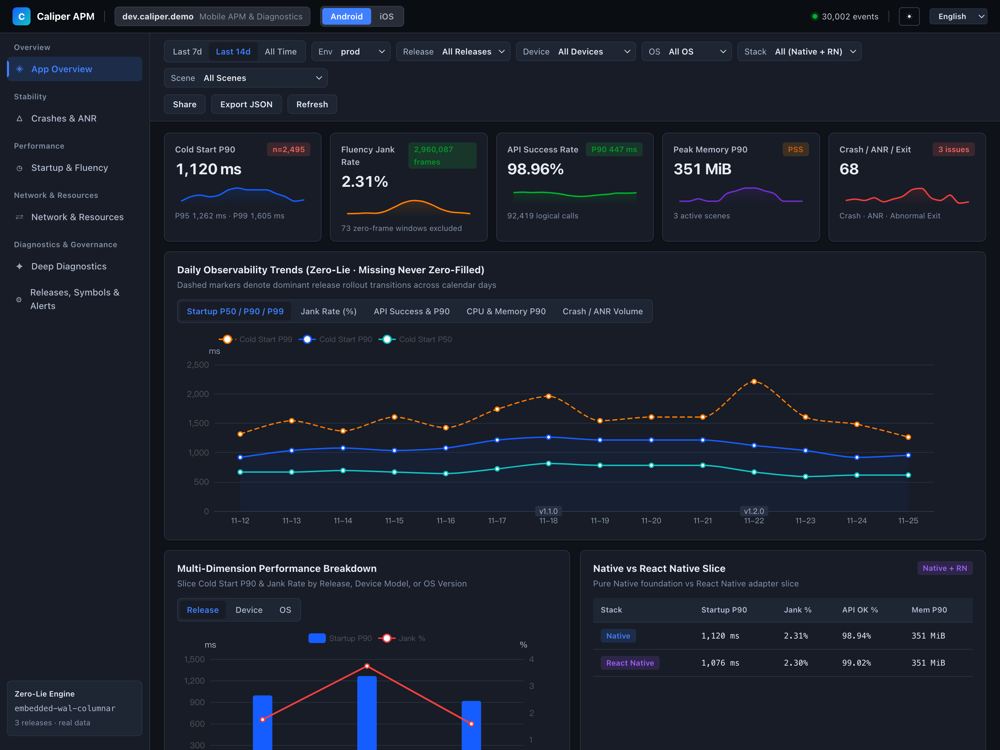
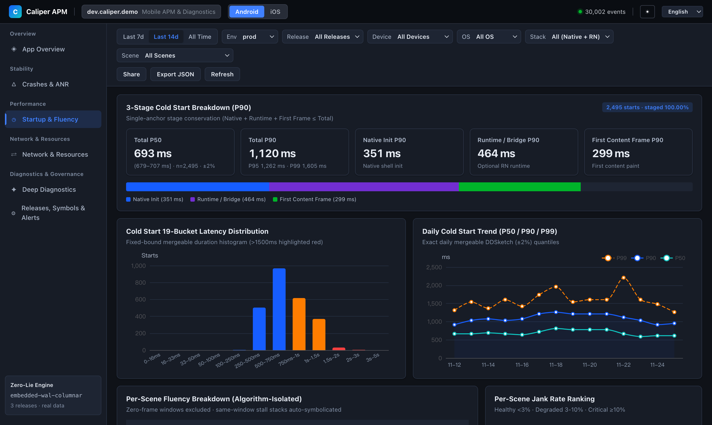
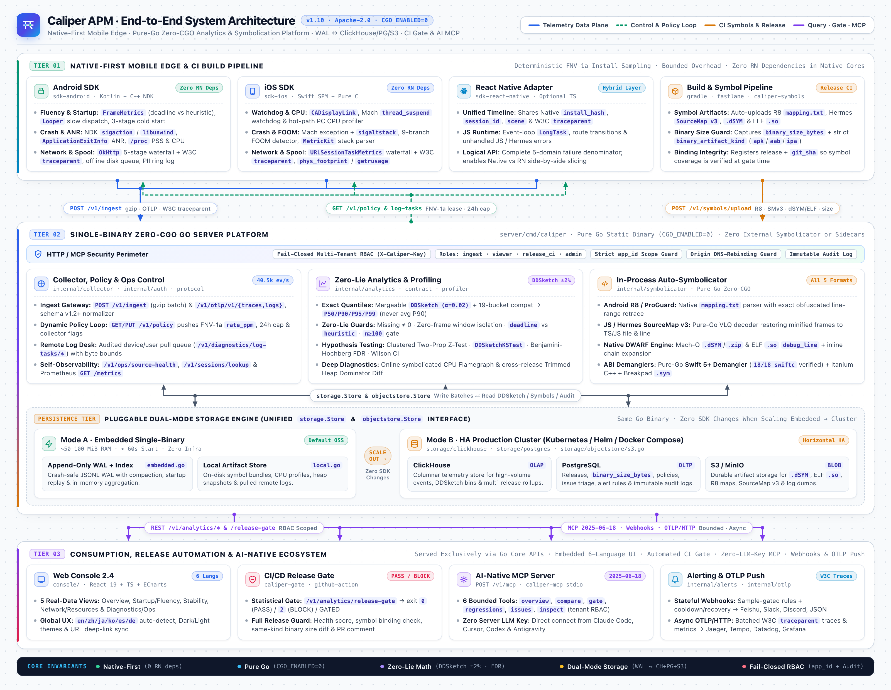

<div align="center">

# Caliper APM

**专为客户端工程师打造的开源移动端 APM：Native 优先、React Native 一等融合、双端真机实测超低开销、统计学零谎言（Zero-Lie）。**

[](https://caliper-apm.github.io/caliper/?lang=zh&theme=dark)
[](LICENSE)
[](https://github.com/caliper-apm/caliper/releases)
[](https://github.com/caliper-apm/caliper/actions/workflows/ci.yml)
[](https://github.com/caliper-apm/caliper/actions/workflows/docker-e2e.yml)
[](server/go.mod)

[English](README.md) · **简体中文** · [日本語](README.ja.md) · [한국어](README.ko.md) · [Español](README.es.md) · [Deutsch](README.de.md)

**[🚀 在线体验 Web 后台（3 万条真实回放数据）](https://caliper-apm.github.io/caliper/?lang=zh&theme=dark)** · [Android SDK](docs/sdk-android.md) · [iOS SDK](docs/sdk-ios.md) · [RN 适配层](docs/sdk-react-native.md) · [真机实测报告](benchmarks/REPORT.md) · [系统架构](docs/architecture.md) · [自托管部署](docs/self-hosting.md) · [更新日志](CHANGELOG.md)

<br />

<a href="https://caliper-apm.github.io/caliper/?lang=zh&theme=dark"></a>

*点击上方预览图（或 **[直接打开在线交互演示后台](https://caliper-apm.github.io/caliper/?lang=zh&theme=dark)**），无需部署即可在浏览器里实操 30,002 条真实回放数据——支持切换 Android / iOS、灰度版本对比、Native vs RN 切面、在线 CPU 火焰图、堆内存泄漏对比、暗黑/亮色主题与 6 国语言。*

</div>

---

## Console 2.4 控制台实拍（100% 真实入库数据）

| **冷启动三阶段 & 19 桶耗时分布** | **网络监控（5 域失败归因 + 延迟分布）** |
| :---: | :---: |
|  |  |
| **深度诊断（在线 CPU 火焰图 & 堆 Dominator 对比）** | **崩溃 / ANR 堆叠趋势与异常治理（亮色模式）** |
|  |  |

---

## 为什么客户端团队需要 Caliper APM？

中大型移动 App 往往采用 **Native 承载核心高体验链路（首页 Feed、冷启动、底层网络、音视频）+ React Native 承载高频迭代业务页** 的混合架构。客户端在做性能治理与稳定性排查时，经常卡在三个痛点上：

- **纯端侧诊断库（Matrix / KOOM / xCrash）缺后端闭环**：只能本地产数据，缺少跨版本统计学对比、自动化符号还原、线上告警与 CI 发版阻断门禁；
- **重型通用可观测平台“不懂移动端”**：自托管动辄 16–32 GB 内存起跳，且缺少 Android `FrameMetrics` 严格口径、iOS 9 分支 FOOM 状态机、三阶段冷启动守恒拆分和 RN 550× 过桥压缩；
- **商业闭源 APM 昂贵且黑盒**：统计口径不透明（把每日 P90 直接求平均、把零帧窗口算作 0% 卡顿），客户端同学难以拿数据做可信的放量决策。

**Caliper APM** 坚持 **Native 优先、低开销安全红线、Zero-Lie 统计闭环**，让你用极低侵入把 Android / iOS / RN 端侧性能、稳定性、网络、CPU 火焰图和发版门禁一次打通。

---

## 移动端三端核心能力全景

| 监控与诊断维度 | Android SDK（Kotlin + C++ NDK · **零 RN 依赖**） | iOS SDK（Swift SPM + `8.4 KiB` 纯 C/Mach · **零 RN 依赖**） | React Native 适配层（可选 TS） |
|---|---|---|---|
| **冷启动三阶段** | `Process.getStartElapsedRealtime` → `Application.onCreate` → 首帧单调时钟守恒拆分（`native + runtime + first_frame <= total`） | 进程启动时间 → 初始化 → `markFirstContentFrame()` 守恒拆分 | 挂载原生冷启，独立追踪 RN 路由首屏与多阶段业务链路 |
| **流畅度 & 卡顿** | 后台 `HandlerThread` `FrameMetrics`（API 31+ `DEADLINE` 与 API 26–30 `heuristic` 严格隔离）、零帧窗口隔离、主线程 `Looper` 慢派发与 20 条消息历史、`CaliperWatchdog` | `CADisplayLink`（适配 120Hz ProMotion）、后台线程 Mach `thread_suspend` + `vm_read_overwrite` 抓真主线程卡顿栈（防自死锁） | JS Event-Loop `LongTask` 窗口聚合，与原生流畅度同窗归因 |
| **崩溃 / ANR / FOOM** | 链式 Java 异常 + NDK `libcaliper_native.so`（**零 `libc++_shared.so`**、`sigaltstack` + `_Unwind_Backtrace` + `SIGQUIT` ANR 透传）+ API 30+ `ApplicationExitInfo` | 纯 C Mach Exception + `sigaltstack` + 损坏帧指针安全回溯 + **9 分支 FOOM 前台 OOM 状态机** + `MetricKit` 调用栈解析 | 捕获未处理 JS / Hermes 异常，由服务端自动通过 Hermes `SourceMap v3` 还原至 TS/TSX 行号 |
| **网络 & 全链路追踪** | `OkHttp` 5 阶段传输瀑布（DNS / TCP / TLS / TTFB / Body + 连接复用率）+ 白名单注入 W3C `traceparent` + **Gradle ASM9 无侵入织入** | `CaliperAutoURLSessionDelegate` 安全透传代理（不干扰 SSL Pinning 与鉴权）+ `URLSessionTaskMetrics` 瀑布 + W3C `traceparent` | `wrapFetchForDenominator` 全量 5 域失败分母（DNS / TLS / 超时 / HTTP / 业务），单次 `42 ns`，**550× 过桥压缩** |
| **CPU 采样 & 专项探针** | `CaliperCpuProfiler` Java 栈采样、`/proc` PSS/CPU、电量/热节流、零 PII 磁盘审计、WebView 白屏/首屏、自定义业务链路 `@CaliperTrace` | `CaliperIOSCPUProfiler`（Mach 热路径零 `dladdr` / 零分配 PC 采样）、`phys_footprint` / `getrusage`、热状态、磁盘审计、`WKWebView` 探针、SwiftUI `.caliperScene()` | `recordCustomJourney` 自定义多阶段业务链路；Console 2.4 支持 **Native vs RN** 一键切面对比 |
| **构建集成 & 自动符号化** | Gradle 插件 `io.caliper.apm.autoinstrument` & `io.caliper.apm.symbols`（已实测 **AGP 8.7.3 + R8 8.7.18 + NDK 27** 全混淆留存） | Fastlane 插件自动上传 `.dSYM` & IPA 字节体积；纯 Go 进程内 Mach-O DWARF 内联展开 + **Swift 5+ / Itanium C++ Demangler** | `caliper-symbols` 一键上传 Hermes `.map` 符号包，纯 Go VLQ 解析 |

---

## 双端物理真机 Release 开销实测（2026-11-23）

客户端引入 APM 前最怕“拖慢启动、掉帧、涨包体、自己崩”。我们在物理真机 Release 模式下做了严格的 **SDK OFF vs ON** 对照实测（完整方法与原始分布见 [`benchmarks/REPORT.md`](benchmarks/REPORT.md)，可通过 `./benchmarks/collect-device-bench.sh` 复现）：

| 实测平台 / 组件 | 压测场景（Release OFF vs ON） | 实测增量结果 |
|---|---|---|
| **Android 真机（`vivo V2343A`，Android 14 / AOT）** | 20 轮冷启 + 15 轮滑动 + `TOTAL PSS` + APK 体积 | 冷启 **`+6.0 ms` P50（`-1 ms` P95）** · 掉帧 **`+0.00%`** · PSS **`+2.67 MiB`** · APK **`+28.0 KiB`** · 自崩溃 **`0 / 26`** |
| **iOS 真机（`iPhone 13 Pro Max`，120Hz ProMotion，`-O`）** | 18 轮冷启 + 3×3s 滑动 + `phys_footprint` + Mach-O | 冷启 **`+3.98 ms` P50（`+1.51 ms` P90）** · 掉帧 **`+0.00%`** · 内存 **`+0.34 MiB`** · CPU **`+0.10%`** · 体积 **`+247.5 KiB`** · 自崩溃 **`0 / 20`** |
| **RN 适配层（`sdk-react-native`）** | 10 万次逻辑 API + 1 万次 LongTask | 单次 API 开销 **`42 ns`** · **`550×`** 过桥流量压缩 |
| **Go 单二进制服务端 + Chaos Lab E2E** | 99,996 条 Gzip WAL 回放 + 三端真符号化 + 双 Webhook | 吞吐 **`33.6k–76.9k events/s`** · 版本对比 **`0.17–0.90 ms`** · 全链路验收 **`2.74–2.96 s`** |

---

## 3 分钟端侧极简接入实战

### 1. Android 接入（纯 Kotlin，零 RN 依赖 · 详见 [`docs/sdk-android.md`](docs/sdk-android.md)）

在 `Application.onCreate` 中一行启动 `CaliperAndroidAgent`，即可自动接管冷启动、FrameMetrics 流畅度、NDK/Java 崩溃、ANR/Looper、内存 CPU、磁盘审计与远程日志：

```kotlin
class MyApp : Application() {
    override fun onCreate() {
        super.onCreate()
        val config = CaliperConfig(
            endpointUrl = "https://apm.example.com",
            apiKey = BuildConfig.CALIPER_INGEST_KEY,
            resource = ResourceIdentity(
                appId = packageName,
                appVersion = BuildConfig.VERSION_NAME,
                buildNumber = BuildConfig.VERSION_CODE.toString(),
                gitSha = BuildConfig.GIT_SHA,
                installHash = InstallationHash.stableHex16(this), // 非 PII 16-64 位十六进制哈希
            ),
            tracePropagationTargets = listOf(".example.com"), // 白名单注入 W3C traceparent
        )
        CaliperAndroidAgent.install(this, config)
    }
}

// 首页 Activity 首个有效内容帧打点（自动完成三阶段冷启守恒拆分）：
window.decorView.post { CaliperAndroidAgent.markFirstContentFrame() }
```

在 `app/build.gradle.kts` 启用 **ASM9 无侵入字节码插桩（自动织入 OkHttp 瀑布与 `@CaliperTrace`）+ R8 符号自动上传**：

```kotlin
plugins {
    id("io.caliper.apm.autoinstrument")
    id("io.caliper.apm.symbols")
}
caliperAutoInstrument {
    enabled.set(true)
    instrumentOkHttp.set(true)       // 自动挂接 OkHttp DNS/TCP/TLS/TTFB 瀑布 + W3C traceparent
    instrumentCaliperTrace.set(true) // 自动统计 @CaliperTrace 标注的核心业务函数
    includePackages.set(listOf("com.example.app"))
}
caliperSymbols {
    serverUrl.set("https://apm.example.com")
    apiKey.set(providers.environmentVariable("CALIPER_API_KEY"))
    appId.set("com.example.app")
}
```

### 2. iOS 接入（Swift Package Manager，零 RN / 三方依赖 · 详见 [`docs/sdk-ios.md`](docs/sdk-ios.md)）

通过 SPM 引入本地或子模块包 `packages/sdk-ios`，一行初始化 `CaliperIOSAgent` 自动拉起 C/Mach 崩溃内核、9 分支 FOOM、Mach Watchdog、MetricKit、VC 页面切换、热状态与每日磁盘审计：

```swift
import CaliperSDK

let config = CaliperConfig(
    endpointURL: URL(string: "https://apm.example.com")!,
    apiKey: ProcessInfo.processInfo.environment["CALIPER_INGEST_KEY"],
    resource: ResourceIdentity(
        appID: Bundle.main.bundleIdentifier ?? "com.example.app",
        appVersion: Bundle.main.infoDictionary?["CFBundleShortVersionString"] as? String ?? "1.0.0",
        buildNumber: Bundle.main.infoDictionary?["CFBundleVersion"] as? String ?? "1",
        installHash: InstallationHash.stableHex16()
    ),
    tracePropagationTargets: [".example.com"]
)
let client = CaliperIOSAgent.install(config: config)

// 首帧打点 / SwiftUI 场景标注 / URLSession 无侵入透传代理（不干扰 SSL Pinning）：
CaliperIOSAgent.markFirstContentFrame()
// SwiftUI: RootView().caliperScene("home_feed")
// Network: let session = CaliperAutoURLSessionDelegate.makeSession(client: client, forwardingTo: myDelegate)
// WKWebView: CaliperWKWebViewBridge.attach(to: webView.configuration.userContentController, client: client)
```

在 `Fastfile` 中自动上传 `.dSYM` 并顺带登记精确 IPA 包体积（零端侧开销）：

```ruby
caliper_upload_symbols(
  server_url: "https://apm.example.com",
  api_key: ENV["CALIPER_API_KEY"],
  app_id: "com.example.app",
  app_version: get_version_number,
  build_number: get_build_number,
  kind: "dsym",
  symbol_path: lane_context[SharedValues::DSYM_OUTPUT_PATH],
  binary_path: lane_context[SharedValues::IPA_OUTPUT_PATH] # 自动记录 IPA 字节大小供发版门禁对比
)
```

### 3. React Native 混合栈挂接（可选 TS 适配层 · 详见 [`docs/sdk-react-native.md`](docs/sdk-react-native.md)）

直接复用原生 `CaliperClient` 的采样租约、离线队列与设备标识，不重复建网、不丢上下文：

```ts
import { CaliperRNAdapter, wrapFetchForDenominator } from '@caliper-apm/react-native';
import { NativeModules } from 'react-native';

export const caliperRN = new CaliperRNAdapter({
  setScene: (scene) => NativeModules.CaliperRNBridge.setScene(scene),
  enqueueEvent: (kind, scene, windowId, payloadJson) =>
    NativeModules.CaliperRNBridge.enqueueEvent(kind, scene, windowId, payloadJson),
});

// 1. 接管全局 fetch，按 5 大失败域与 19 桶耗时在 JS 内存窗口聚合（550x 过桥压缩）
globalThis.fetch = wrapFetchForDenominator(globalThis.fetch, caliperRN, {
  allowHosts: ['api.example.com'],
});
// 2. 与原生流畅度/内存窗口对齐页面场景，按窗口批量冲刷
caliperRN.setScene('streaming_reader');
setInterval(() => caliperRN.flushWindow(), 30_000);
```

### 4. CI 统一符号包 & 包体积上传（R8 / `.so` / `.dSYM` / Hermes `.map`）

```bash
caliper-symbols upload \
  --server https://apm.example.com --api-key "$CALIPER_API_KEY" \
  --app-id com.example.app --platform android --version 1.1.0 --build 110 --git-sha "$(git rev-parse --short=12 HEAD)" \
  --kind r8_mapping --file app/build/outputs/mapping/release/mapping.txt \
  --binary-file app/build/outputs/apk/release/app-release.apk
```

---

## 端侧安全红线与现有工具无缝共存

客户端团队最怕接入 APM 后引入隐性崩溃、刷爆用户流量或与现有自研工具冲突。Caliper 端侧严格遵守 4 条工程红线：

1. **Native 内核零 RN 依赖**：纯原生 Android / iOS App 接入时不带入任何 React Native / JSI / 第三方重型库；Android NDK 库 `libcaliper_native.so` 零 `libc++_shared.so` 依赖，iOS Mach 崩溃内核仅 `8.4 KiB`。
2. **零高危全局 Hook + 开放外部探针桥接（`CaliperExternalProbeBridge`）**：核心 SDK 拒绝不稳定的底层全局 Hook（如高版本系统易崩的私有 API Hook），同时在 Android / iOS 双端内置标准 `CaliperExternalProbeBridge`（`ingestExternalCrash` / `ingestExternalLagOrAnr` / `ingestExternalHangOrLag` / `ingestExternalHeapSnapshot` / `ingestExternalDiagnosticJourney`），可将团队已有的 **Matrix / KOOM / MetricKit / 自定义内存或卡顿探针** 数据直接接入 Caliper 的统一符号化、跨版本堆 Dominator 对比与告警门禁。
3. **Fail-Closed 确定性采样与有界防炸队列**：基于安装哈希的 **FNV-1a 确定性采样租约**（`GET /v1/policy` 后台热调整采样率与探针开关）+ 单设备 24h 上报硬上限 + 有界 FIFO 离线磁盘队列（超配额淘汰最旧文件、指数退避熔断，绝不撑爆磁盘或引发 OOM）。
4. **隐私合规与强审计远程捞日志**：单用户排查仅使用非 PII 十六进制 `user_hash` / `install_hash`；端侧环形日志 `CaliperDiagnosticRingLog` 自动脱敏邮箱/手机号/Token，仅在服务端下发带 TTL 与字节上限的授权任务时回传，全链路写入不可篡改审计日志。

---

## 整体系统架构

<p align="center">
  <picture>
    <source media="(prefers-color-scheme: dark)" srcset="docs/assets/architecture-dark.png" />
    <source media="(prefers-color-scheme: light)" srcset="docs/assets/architecture-light.png" />
    
  </picture>
</p>

- **数据面与控制面双闭环**：Android / iOS / RN 端侧通过 `POST /v1/ingest`（Gzip + W3C `traceparent`）上报遥测流，同时反向拉取 FNV-1a 确定性采样租约（`GET /v1/policy`）与有界远程日志捞取任务；CI 构建插件同步上传全格式符号表与同格式包体积元数据（`binary_size_bytes`）。
- **单二进制零 CGO 纯 Go 引擎**：`server/cmd/caliper`（`CGO_ENABLED=0`）单进程整合 Fail-Closed 多租户 RBAC、Zero-Lie `DDSketch (±2%)` 统计学回归引擎（聚类 Z 检验 / KS / FDR）、火焰图与堆 Dominator 分析，以及 R8 / SourceMap v3 / Mach-O `.dSYM` / ELF `.so` DWARF / Swift 5+ 全格式进程内符号化，无需独立 Symbolicator 微服务。
- **双模可插拔存储与开放生态**：通过统一的 `storage.Store` 与 `objectstore.Store` 接口，既可 60 秒单二进制嵌入式 WAL 轻量化起步（~50–100 MiB RAM），也可零改动 SDK 平滑水平扩展至 **ClickHouse + PostgreSQL + S3/MinIO** 生产集群，统一对外驱动 6 语言 Console 2.4、`caliper-gate` 发布门禁、AI 原生 MCP Server（`2025-06-18`）、告警 Webhook 与 OTLP/HTTP 异步推送。

---

## 1 分钟本地跑通端云闭环（服务端 + CI 门禁 + AI MCP）

### 方式一：一键拉起本地完整大盘（预置 14 天回归演练数据）
```bash
# Docker Compose（推荐）
git clone https://github.com/caliper-apm/caliper.git && cd caliper
docker compose up --build
# 或零 Docker 本地启动（需 Go 1.23+ & Node 22+）：./scripts/dev-quickstart.sh
# 打开 http://localhost:8080 即可查看 v1.0.0 -> v1.1.0（回归）-> v1.2.0（修复）完整闭环
```
也可运行 `./demo-app/chaos-lab/run-chaos-e2e.sh`（< 3 秒），自动完成三端 R8 / SourceMap / dSYM 符号上传、故障注入、源码行还原与飞书/Slack 真实 Webhook 投递验收。

### 端到端发版与排障四大工程闭环
- **Zero-Lie 统计学回归引擎（单机与 ClickHouse 精度一致）**：纯 Go 零依赖 **DDSketch（$\alpha = 2\%$）** 输出可合并 `P50 / P90 / P95 / P99` 与 `DDSketchKSTest` 桶内劣化检测（绝不平均每日 P90）；缺值绝不补零、零帧窗口隔离、Android `deadline`/`heuristic` 隔离、卡顿率采用窗口聚类 Z 检验（`cluster_proportion_z`）+ 分场景 **Benjamini-Hochberg FDR** 多重检验校正 + 最小样本门禁（`n >= 100`）。
- **零外部服务的纯 Go 5 格式自动符号化**：单二进制进程内还原 **R8/ProGuard**、**JS/Hermes SourceMap v3**、**Mach-O `.dSYM` / Android NDK ELF `.so` DWARF（含内联栈展开）**、**纯 Go Swift 5+（18/18 实编符号与 `xcrun swift-demangle` 交叉验证匹配）& Itanium C++ Demangler** 与 **Breakpad `.sym`**。
- **CI/CD 发版质量门禁（`caliper-gate` + GitHub PR Action）**：灰度期间一键判定 `PASS (0)` / `BLOCK (2)` / `GATED (3)`，自动校验崩溃/流畅度/启动回归、符号绑定完整度与**同类型包体积增量**（绝不拿 `.aab` 与 `.apk` 混比）并在 PR 自动发表 Markdown 报告：
  ```bash
  caliper-gate --server http://127.0.0.1:8080 --platform android --baseline 1.0.0 --candidate 1.1.0 --format markdown
  ```
- **AI 原生 MCP Server（直接在 IDE 里查线上崩溃定位源码）**：内置纯 Go 标准 MCP JSON-RPC 2.0 服务端（`POST /v1/mcp` Streamable HTTP `2025-06-18` + `caliper-mcp` stdio，**服务端无需配置外部 LLM Key**，严格 Fail-Closed 多租户 RBAC 隔离），向 **Cursor / Claude Code / Codex / Antigravity** 暴露 `caliper_overview`、`caliper_compare_releases`、`caliper_evaluate_gate`、`caliper_scan_regressions`、`caliper_list_issues`、`caliper_inspect_issue`（自动触发全格式符号化）六大诊断工具：
  ```json
  {
    "mcpServers": {
      "caliper-apm": {
        "command": "caliper-mcp",
        "args": ["--server", "http://127.0.0.1:8080"]
      }
    }
  }
  ```
- **告警、全双工 OTLP 与生产集群平滑扩展**：支持 **飞书交互卡片 / Slack / Discord / 通用 Webhook**（样本量门禁 + 冷却去重 + 恢复通知）；支持 OTLP 接收与异步 Trace 推送（`--otlp-traces-endpoint`，直连 Jaeger / Grafana Tempo / Datadog）；生产期零改动 SDK 切换 **ClickHouse + PostgreSQL + S3/MinIO + Kubernetes Helm**（详见 [`docs/self-hosting.md`](docs/self-hosting.md)）。
  > *能力边界诚实说明*：服务端火焰图引擎、堆 Dominator 跨版本 Diff，以及 Android (`CaliperCpuProfiler`) 与 iOS (`CaliperIOSCPUProfiler`) CPU 采样器均已实装并纳入 CI 验证；Hermes 自动 CPU 采样器与端侧可选 HPROF 自动裁剪采集规划在 v2.0，现阶段可通过 `CaliperExternalProbeBridge` 接入团队现有堆诊断探针。

---

## 生态差异化定位（零夸大诚实对标）

| 开源 / 商业方案 | 协议 | 核心长板 | 与 Caliper APM 的定位差异 |
|---|---|---|---|
| **腾讯 Matrix / 字节开源工具（`btrace`/`ShadowHook`/`ByteHook`/`Tailor`）/ 快手 KOOM / xCrash** | BSD-3 / Apache-2.0 / MIT | 业界顶尖的端侧底层 Hook、HPROF 裁剪、Perfetto 深度 Trace 与内存泄漏分析。 | 属于纯端侧诊断库，缺少开箱即用的采集后端、符号化流水线、跨版本对比大盘与发版门禁。Caliper 坚守零高危 Hook 安全红线，同时提供 `CaliperExternalProbeBridge` 可直接承接它们的产出形成端云闭环。 |
| **Sentry Self-Hosted** *（及轻量化平替 GlitchTip / Bugsink）* | FSL-1.1-Apache-2.0 *（2 年后转 Apache-2.0）* | 30+ 语言成熟生态、移动端 Session Replay 与海量集成插件。 | Sentry 自托管需 16–32 GB 内存与 20+ 容器；GlitchTip/Bugsink 偏错误追踪而非移动端性能回归体系。Caliper 为纯 OSI **Apache-2.0**，单二进制零 CGO 起步，聚焦移动端 Zero-Lie 统计学发版门禁。 |
| **Measure.sh** | Apache-2.0 | 新一代移动端开源 APM，覆盖 Android/iOS/Flutter/RN(Expo)/KMP、轻量视图树快照时间线与 MCP Server。 | Caliper 差异化在于 **Zero-Lie 统计学严谨度**（单机与 ClickHouse 全链路 DDSketch ±2%、零帧与算法隔离、窗口聚类 Z 检验、BH-FDR 校正）、单二进制极速启动 + 纯 Go Swift 5+/DWARF 符号化，以及原生 CI/CD `caliper-gate` 阻断门禁。 |
| **OpenTelemetry Mobile / Embrace 开源 SDK + Grafana / SigNoz** | Apache-2.0 | 开放中立的 OTLP 生态，易于与后端微服务统一。 | 需自建移动端流畅度/FOOM 口径、原生 dSYM/R8/SourceMap 自动符号化与灰度统计门禁。Caliper 通过 OTLP 接收 + 异步 Trace 推送与其无缝互通，同时开箱补齐移动端专属闭环。 |

---

## 文档中心

| 文档 | 内容概览 |
|---|---|
| [`docs/sdk-android.md`](docs/sdk-android.md) | 纯 Kotlin Android 接入（`CaliperAndroidAgent`、`FrameMetrics`、NDK/ANR、ASM9 与 R8 Gradle 插件、`vivo V2343A` 实测） |
| [`docs/sdk-ios.md`](docs/sdk-ios.md) | 纯 Swift SPM iOS 接入（`CaliperIOSAgent`、Mach 崩溃/Watchdog/CPU 采样、FOOM、MetricKit、Fastlane、`iPhone 13 Pro Max` 实测） |
| [`docs/sdk-react-native.md`](docs/sdk-react-native.md) | React Native 一等适配层（`wrapFetchForDenominator`、550× 过桥流量压缩、Hermes SourceMap v3、原生桥接） |
| [`benchmarks/REPORT.md`](benchmarks/REPORT.md) | 双真机 Release OFF vs ON 全量基准测试数据与 North Star 性能门禁 |
| [`docs/architecture.md`](docs/architecture.md) | 端到端系统拓扑、Zero-Lie 直方图与统计门禁原理、Clean-Room 架构设计 |
| [`docs/self-hosting.md`](docs/self-hosting.md) | Embedded WAL 单二进制 vs ClickHouse + PG + S3 高可用集群、Helm 部署、RBAC、PR 门禁与 Prometheus |
| [`spec/metrics-contract.md`](spec/metrics-contract.md) & [`NORTH_STAR.md`](NORTH_STAR.md) | 冻结北极星宪章与 Zero-Lie 统计契约 |

---

## 开源协议

基于 [Apache License 2.0](LICENSE) 开源。
