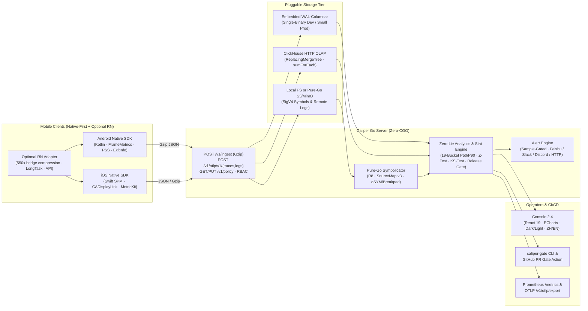
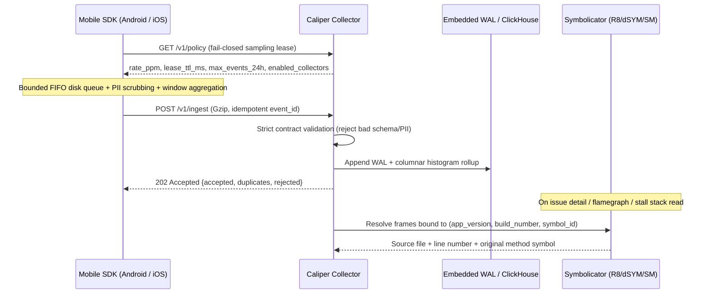

# Caliper APM Architecture

Caliper APM is designed around three non-negotiable engineering axioms frozen in [`NORTH_STAR.md`](../NORTH_STAR.md):
1. **Native-First, React Native Compatible**: Android (`caliper-core` / `caliper-android`) and iOS (`CaliperSDK`) ship with **zero React Native dependencies**. Hybrid apps attach `@caliper-apm/react-native` onto the exact same Native lifecycle, window correlation, and symbolication timeline.
2. **Zero-Lie Statistics (Evidence-First)**: Fixed-bound 19-bucket mergeable histograms (never averaging daily P90s), zero-frame windows strictly isolated from smoothness denominators, missing values never zero-filled, Android API 31+ `deadline` separated from API 26–30 `heuristic`, and explicit sample-size gates (`n >= 20` display, `n >= 100` release comparison).
3. **Zero-CGO Single Binary -> Horizontal Cluster**: Start on a laptop with one pure-Go binary (`EmbeddedStore` WAL), and scale seamlessly to ClickHouse OLAP + S3/MinIO object storage + Kubernetes Helm without changing a single mobile SDK line.

---

## End-to-End System Topology

---

## Core Data Pipeline Guarantees

---

## Honest Architectural Comparison

| Capability | Caliper APM (Apache-2.0) | Typical Commercial Mobile APM | General-Purpose OSS Observability |
|---|---|---|---|
| **Native-First (Zero RN deps)** + Hybrid RN Correlation | Native Kotlin/Swift core + 550× RN bridge compression | Often native-only or heavy multi-MB SDKs | Limited mobile frame/ANR/PSS depth |
| **Statistical Rigor (Zero-Lie)** | Mergeable 19-bucket histograms, Z-test + Wilson CI + KS-test, explicit sample gates, zero-frame isolation | Opaque closed-source aggregation formulas | Manual PromQL/SQL required per team |
| **Self-Hosting Footprint** | 1 pure-Go binary (embedded WAL) or ClickHouse + S3 | Closed SaaS / heavy enterprise license | Multi-service cluster required upfront |
| **CI/CD Statistical Release Gate** | Built-in `caliper-gate` CLI + GitHub PR Action (`exit 0/2/3`) | Usually manual dashboard checks | Custom scripting required |
| **Build-Bound Auto-Symbolication** | Built-in pure-Go R8, SourceMap v3, dSYM/Breakpad | Built-in | Requires external symbolication service |
| **Data Ownership & Privacy** | Non-PII hex hashes only, fail-closed audited UID trace & remote log pull | Vendor-hosted | Self-hosted |
| **Verified Physical Overhead** | Android `+6.0 ms` / `+28 KB` APK; iOS `+3.98 ms` / `+0.34 MiB` mem | Rarely published with reproducible harnesses | N/A |
